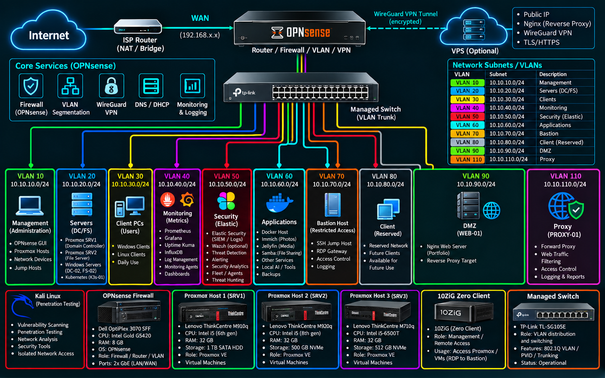

# Homelab Architecture

**Infrastructure Overview | Network Segmentation | Virtualization | Security Monitoring**

## Overview

This document provides a high-level overview of my personal homelab infrastructure, including its network architecture, virtualization environment, VLAN segmentation and core services.

The environment is built around Proxmox VE and OPNsense, integrating Windows and Linux systems, security monitoring and dedicated network segments.

## Infrastructure Architecture

The diagram below illustrates the overall homelab architecture, including the Internet connection, firewall, managed switching, VLANs, virtualization hosts and infrastructure services.

## Main Components

- **Network & Firewall:** OPNsense, managed switch, VLAN segmentation and WireGuard VPN.
- **Virtualization:** Proxmox VE hosts running virtual machines and services.
- **Infrastructure Services:** Active Directory, DNS, DHCP, Linux servers and application services.
- **Security:** Elastic Security, Suricata IDS and dedicated security environments.
- **Network Services:** DMZ, reverse proxy, Squid Proxy and Bastion host.
- **Monitoring:** Centralized logging, Prometheus and Grafana.

## Network Design

The infrastructure uses VLAN-based segmentation to separate management, servers, clients, monitoring, security, applications and other dedicated environments.

Inter-VLAN communication is managed through OPNsense firewall rules.

## Purpose

This homelab serves as a practical learning environment for infrastructure administration, networking, virtualization and cybersecurity.

It is continuously evolving through hands-on configuration, troubleshooting and security projects.

