# OPNsense Firewall Configuration

> **Project:** Infrastructure Security Lab  
> **Platform:** OPNsense  
> **Role:** Stateful firewall, VLAN gateway, inter-network routing, DHCP/DNS services and network security enforcement  
> **Documentation status:** Living document — updated from the current OPNsense configuration screenshots. Firewall policies, NAT and runtime validation are being documented as those configurations are completed.

---

## 1. Overview

OPNsense is the central network security and routing platform in this homelab. It connects the WAN to the internal network and provides separate Layer 3 interfaces for the lab's functional network segments.

The network uses IEEE 802.1Q VLAN tagging over the LAN parent interface. Each assigned VLAN has its own IPv4 subnet and OPNsense interface address, allowing traffic between segments to be controlled through interface-specific firewall policies.

The segmentation separates infrastructure services, user endpoints, monitoring, security tooling, applications, administrative access, DMZ workloads, proxy services and the GOAD Active Directory lab. A dedicated malware-analysis network is also defined.

### Design goals

- Segment systems according to their role and trust level.
- Reduce unnecessary east-west traffic between VLANs.
- Provide controlled routing between internal networks.
- Separate administrative access from ordinary client traffic.
- Keep DMZ and malware-analysis workloads in dedicated network segments.
- Centralize network services and security enforcement.
- Support monitoring, traffic analysis and security testing.

## 2. Hardware and Physical Interfaces

### Firewall dashboard

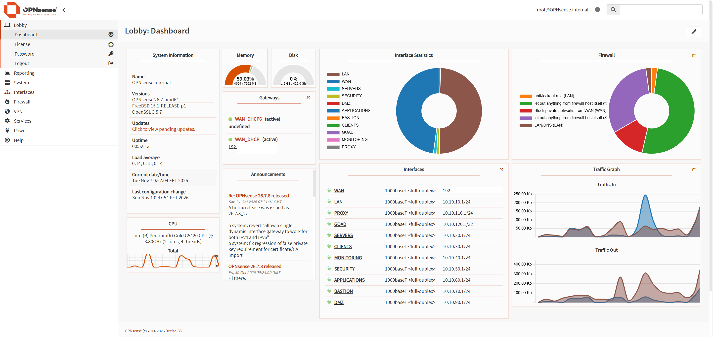

*OPNsense dashboard showing the firewall environment and system overview.*

| Component | Configuration |
|---|---|
| Firewall platform | OPNsense |
| Hardware | Dell OptiPlex SFF |
| WAN interface | `re0` |
| LAN interface / VLAN parent | `em0` |
| LAN IPv4 address | `10.10.10.1/24` |
| VLAN technology | IEEE 802.1Q |
| VLAN parent interface | `em0` |

All VLAN devices shown in the current configuration use `em0` as their parent interface. The WAN is assigned to `re0`.

### Interface assignments

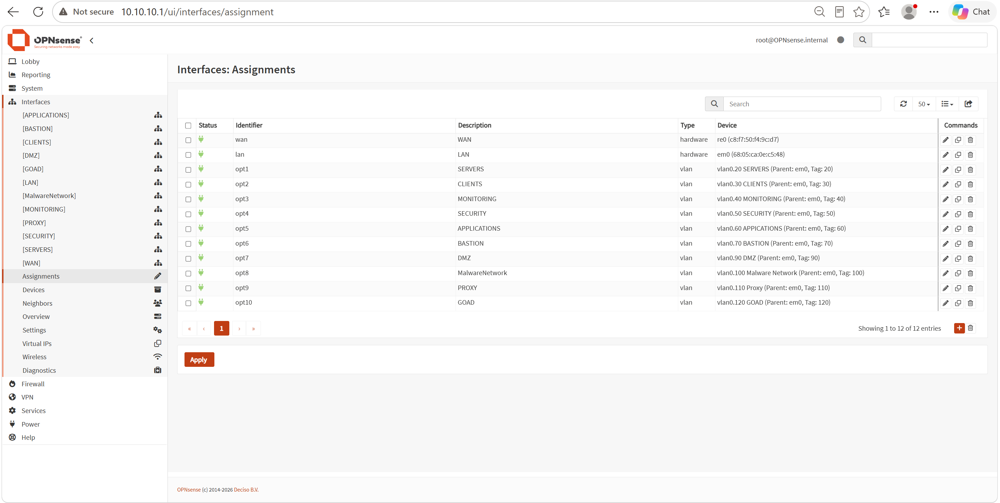

*Physical and logical interface assignments configured on the OPNsense firewall.*

| OPNsense assignment | Interface device | Description |
|---|---|---|
| WAN | `re0` | WAN |
| LAN | `em0` | LAN |
| OPT1 | `vlan0.20` | SERVERS |
| OPT2 | `vlan0.30` | CLIENTS |
| OPT3 | `vlan0.40` | MONITORING |
| OPT4 | `vlan0.50` | SECURITY |
| OPT5 | `vlan0.60` | APPLICATIONS |
| OPT6 | `vlan0.70` | BASTION |
| OPT7 | `vlan0.90` | DMZ |
| OPT8 | `vlan0.100` | MalwareNetwork |
| OPT9 | `vlan0.110` | PROXY |
| OPT10 | `vlan0.120` | GOAD |

The OPT interfaces are renamed in OPNsense to their functional descriptions. The VLAN 10 device exists in the VLAN device list, but it is not shown as a separate interface assignment. The untagged LAN interface currently uses the `10.10.10.1/24` address.

## 3. VLAN Segmentation and IP Addressing

### VLAN device configuration

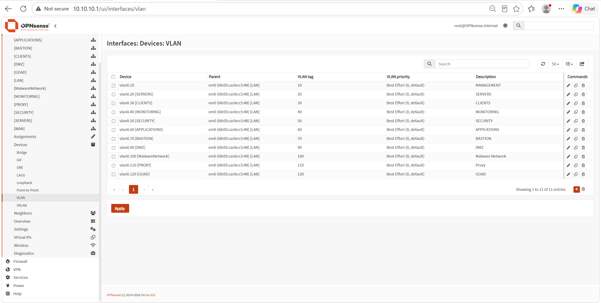

*VLAN devices defined on the OPNsense LAN parent interface.*

The following table reflects the VLAN devices, interface assignments and IPv4 addresses visible in the supplied OPNsense screenshots.

| VLAN ID | Interface | Network | OPNsense gateway | Purpose |
|---:|---|---|---|---|
| 10 | LAN (untagged) | `10.10.10.0/24` | `10.10.10.1` | LAN / Management |
| 20 | SERVERS | `10.10.20.0/24` | `10.10.20.1` | Infrastructure servers |
| 30 | CLIENTS | `10.10.30.0/24` | `10.10.30.1` | Client endpoints |
| 40 | MONITORING | `10.10.40.0/24` | `10.10.40.1` | Monitoring systems |
| 50 | SECURITY | `10.10.50.0/24` | `10.10.50.1` | Security tools and SIEM |
| 60 | APPLICATIONS | `10.10.60.0/24` | `10.10.60.1` | Application services |
| 70 | BASTION | `10.10.70.0/24` | `10.10.70.1` | Administrative access |
| 90 | DMZ | `10.10.90.0/24` | `10.10.90.1` | Public-facing / isolated services |
| 100 | MalwareNetwork | `10.10.100.0/24` | `10.10.100.1` | Controlled malware-analysis lab |
| 110 | PROXY | `10.10.110.0/24` | `10.10.110.1` | Squid proxy and web filtering |
| 120 | GOAD | `10.10.120.0/24` | `10.10.120.1` | Game of Active Directory lab |

**Addressing convention:** Each routed network uses a `/24` subnet, with the OPNsense interface configured as the `.1` default gateway.

### VLAN interface configuration evidence

The following screenshots document the individual network interface configurations. They are grouped here to keep the main addressing table readable while retaining the configuration evidence for each segment.

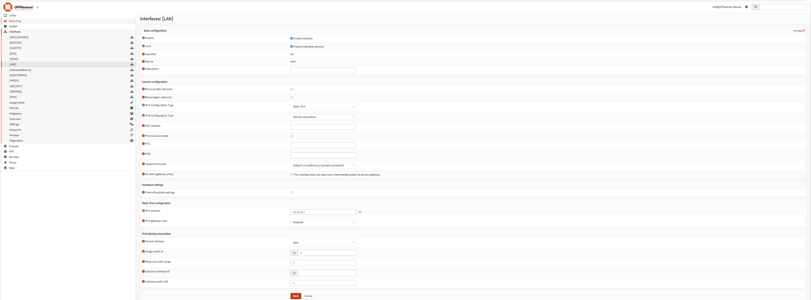

*LAN — untagged management network.*

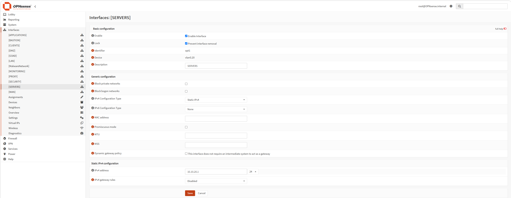

*VLAN 20 — SERVERS.*

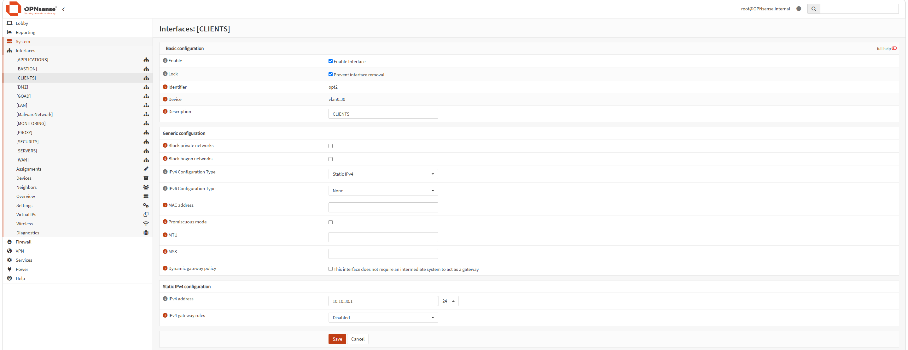

*VLAN 30 — CLIENTS.*

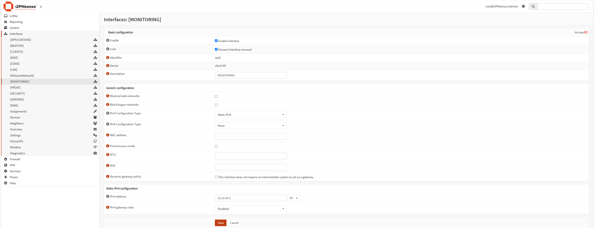

*VLAN 40 — MONITORING.*

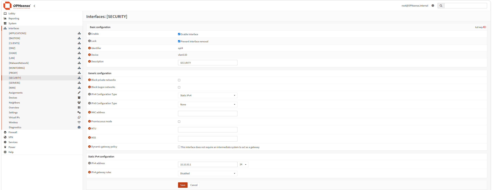

*VLAN 50 — SECURITY.*

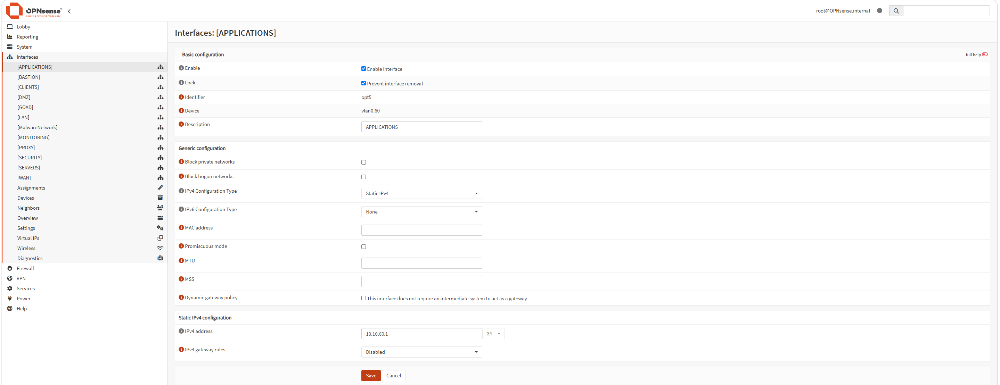

*VLAN 60 — APPLICATIONS.*

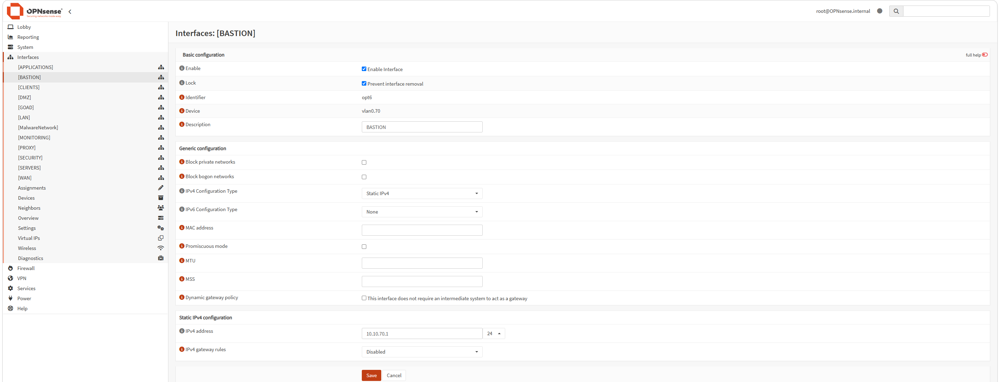

*VLAN 70 — BASTION.*

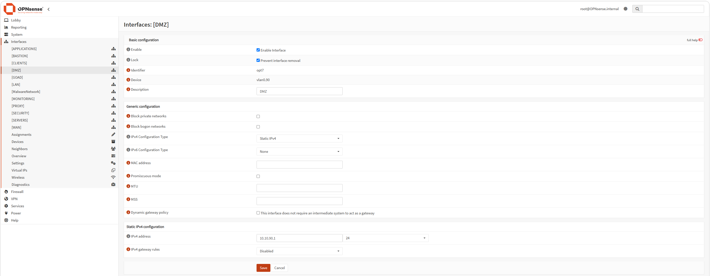

*VLAN 90 — DMZ.*

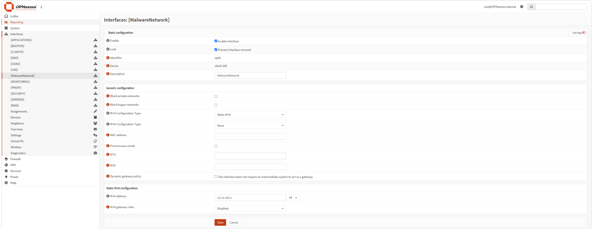

*VLAN 100 — MalwareNetwork.*

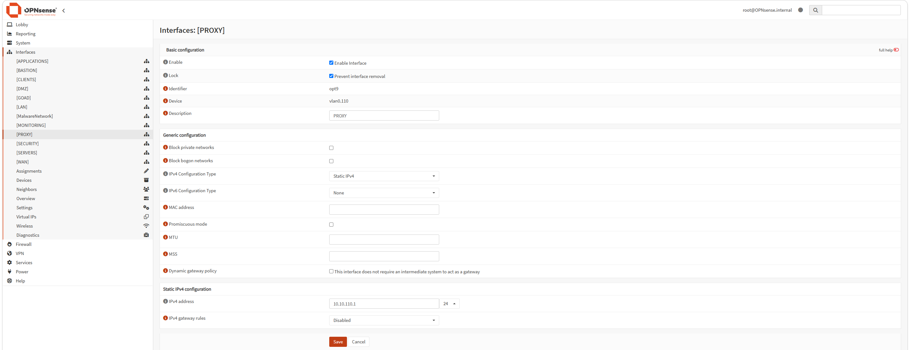

*VLAN 110 — PROXY.*

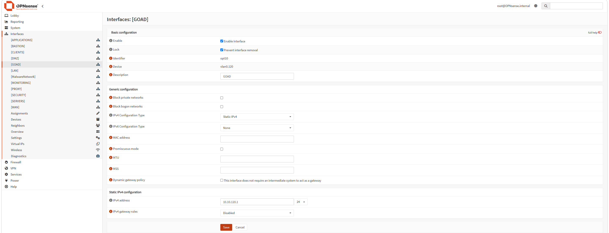

*VLAN 120 — GOAD.*

### Physical switching infrastructure

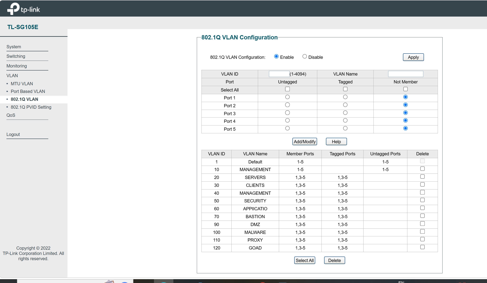

*Managed switch used as part of the homelab network infrastructure. VLAN trunk/access-port configuration should be validated against the switch's running configuration.*

> **VLAN 10 note:** The screenshots show a VLAN 10 device on `em0`, but no separate VLAN 10 interface assignment. The active LAN interface is untagged and uses the same `10.10.10.0/24` subnet. Confirm the intended native/management VLAN design before treating VLAN 10 as a tagged, separately routed interface.

> **VLAN 80:** VLAN 80 appeared in an earlier version of this document, but it is not present in the latest VLAN device and interface-assignment screenshots. It is therefore not listed as an active configured VLAN here.

## 4. DHCP Configuration

The screenshots show configuration for both Dnsmasq DHCP and Kea DHCPv4. Their actual runtime status and interface responsibilities should be verified before considering the DHCP design finalized.

### 4.1 Dnsmasq DHCP ranges

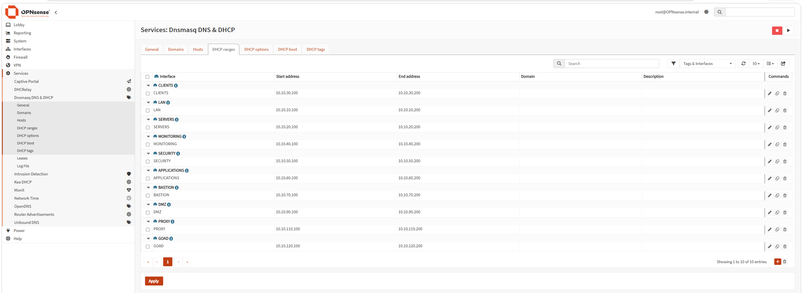

*Configured DHCP address pools for the internal network interfaces.*

The following address pools are visible in the Dnsmasq DHCP ranges page:

| Interface | DHCP pool |
|---|---|
| LAN | `10.10.10.100 - 10.10.10.200` |
| SERVERS | `10.10.20.100 - 10.10.20.200` |
| CLIENTS | `10.10.30.100 - 10.10.30.200` |
| MONITORING | `10.10.40.100 - 10.10.40.200` |
| SECURITY | `10.10.50.100 - 10.10.50.200` |
| APPLICATIONS | `10.10.60.100 - 10.10.60.200` |
| BASTION | `10.10.70.100 - 10.10.70.200` |
| DMZ | `10.10.90.100 - 10.10.90.200` |
| PROXY | `10.10.110.100 - 10.10.110.200` |
| GOAD | `10.10.120.100 - 10.10.120.200` |

No Dnsmasq DHCP range for VLAN 100 (MalwareNetwork) is visible in the supplied ranges screenshot.

### 4.2 Kea DHCPv4 subnet definitions

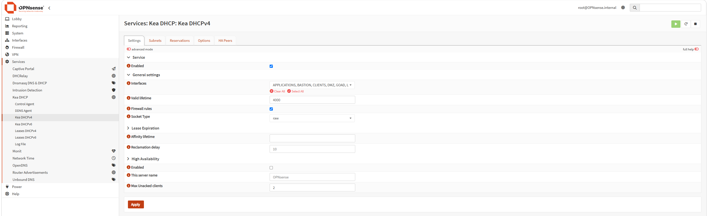

*Configured Kea DHCPv4 service and subnet definitions.*

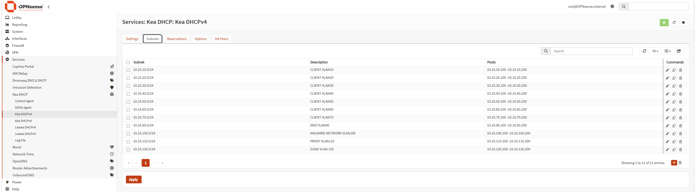

*DHCP subnet and address-pool configuration evidence.*

Kea DHCPv4 is configured with the following subnet definitions and address pools:

| Subnet | Description shown | Pool |
|---|---|---|
| `10.10.10.0/24` | CLIENT VLAN10 | `10.10.10.100 - 10.10.10.200` |
| `10.10.20.0/24` | CLIENT VLAN20 | `10.10.20.100 - 10.10.20.200` |
| `10.10.30.0/24` | CLIENT VLAN30 | `10.10.30.100 - 10.10.30.200` |
| `10.10.40.0/24` | CLIENT VLAN40 | `10.10.40.100 - 10.10.40.200` |
| `10.10.50.0/24` | CLIENT VLAN50 | `10.10.50.100 - 10.10.50.200` |
| `10.10.60.0/24` | CLIENT VLAN60 | `10.10.60.100 - 10.10.60.200` |
| `10.10.70.0/24` | CLIENT VLAN70 | `10.10.70.100 - 10.10.70.200` |
| `10.10.90.0/24` | DMZ VLAN90 | `10.10.90.100 - 10.10.90.200` |
| `10.10.100.0/24` | MALWARE NETWORK VLAN100 | `10.10.100.100 - 10.10.100.200` |
| `10.10.110.0/24` | PROXY VLAN110 | `10.10.110.100 - 10.10.110.200` |
| `10.10.120.0/24` | GOAD VLAN120 | `10.10.120.100 - 10.10.120.200` |

### 4.3 DHCP service settings visible in the screenshots

| Setting | Observed configuration |
|---|---|
| Dnsmasq DNS listen port | `53053` |
| DHCP FQDN | Enabled |
| DHCP local domain | `internal` |
| DHCP register firewall rules | Enabled |
| Router advertisements | Enabled in Dnsmasq |
| Kea DHCPv4 | Service configuration enabled |
| Kea valid lifetime | `4000` seconds |
| Kea reclamation delay | `10` seconds |
| Kea socket type | `raw` |

**Important validation:** Both Dnsmasq and Kea have DHCP-related configuration in the screenshots. Verify which service is actually running and serving each interface. Do not run two DHCP servers for the same broadcast domain unless the arrangement is deliberately designed and coordinated. The Kea configuration also includes VLAN 10 while the current OPNsense LAN interface is untagged; confirm the intended interface/subnet mapping.

## 5. DNS Configuration

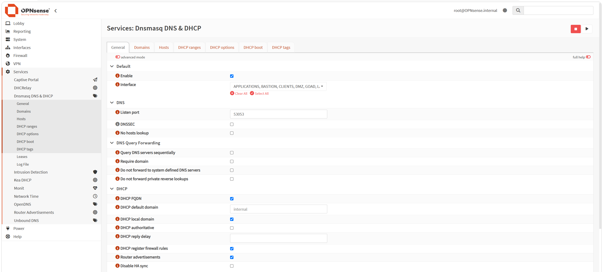

*Dnsmasq service configuration, including DNS/DHCP options.*

Dnsmasq DNS & DHCP is configured with:

- DNS listen port: `53053`.
- DHCP local domain: `internal`.
- DHCP FQDN support enabled.
- DHCP local-domain registration enabled.
- DNS forwarding options available in the service configuration.

The supplied screenshots do not show the configured upstream DNS servers or domain/host overrides. Those details will be added after reviewing the DNS Domains and Hosts pages.

## 6. Network Security and Segmentation Strategy

The VLAN structure provides the foundation for a least-privilege network policy.

| Network | Intended security boundary |
|---|---|
| LAN / Management | Infrastructure and network administration |
| SERVERS | Server-to-server and approved service access |
| CLIENTS | User endpoint access to explicitly permitted services |
| MONITORING | Monitoring and telemetry collection |
| SECURITY | SIEM and security tooling access |
| APPLICATIONS | Application-specific service communication |
| BASTION | Controlled administrative entry point |
| DMZ | Isolated services with explicitly limited access to internal networks |
| MalwareNetwork | Controlled testing environment with restricted connectivity |
| PROXY | Web proxy and filtering services |
| GOAD | Isolated Active Directory attack-and-defence practice environment |

These are the intended security boundaries, not a claim that all corresponding firewall rules have already been implemented. Inter-VLAN permissions must be documented from the actual OPNsense ruleset.

### Recommended policy principles

1. Apply least privilege between VLANs.
2. Permit only required source, destination, protocol and port combinations.
3. Restrict administrative access to approved management paths and the Bastion network.
4. Prevent the DMZ from initiating unrestricted connections to trusted internal networks.
5. Keep malware-analysis traffic isolated from production-like lab services and the home network.
6. Restrict access to firewall management services.
7. Log and review relevant denied traffic and security events.

## 7. Firewall Rules

**Status: Pending documentation.**

The interface rules have not yet been supplied for this update. The following rule areas will be documented after reviewing the actual OPNsense rules:

- LAN
- SERVERS
- CLIENTS
- MONITORING
- SECURITY
- APPLICATIONS
- BASTION
- DMZ
- MalwareNetwork
- PROXY
- GOAD
- WAN

Each documented rule should include its action, interface, direction, protocol, source, destination, destination port, logging setting and purpose.

No specific allow/deny rule is assumed in this document until it is verified in the firewall configuration.

## 8. NAT and Routing

**Status: Pending verification.**

The supplied screenshots establish the internal interface addressing and VLAN gateway configuration. They do not show the outbound NAT mode, port-forwarding rules, static routes or policy-based routing.

These will be added after reviewing the corresponding OPNsense pages.

## 9. Monitoring and Security Integration

The network design includes dedicated segments for monitoring and security tooling:

- **MONITORING (VLAN 40):** reserved for monitoring infrastructure.
- **SECURITY (VLAN 50):** reserved for security tooling, including Elastic Security.
- **PROXY (VLAN 110):** dedicated network for Squid proxy and web-filtering services.
- **MalwareNetwork (VLAN 100):** dedicated network for controlled malware-analysis exercises.

Integration details, log sources, IDS/IPS configuration and alerting workflows will be documented after their configurations are reviewed.

## 10. Validation and Testing

The following checks will be used to validate the network implementation:

| Test | Validation objective | Status |
|---|---|---|
| Interface status | Confirm all expected OPNsense interfaces are up | To be tested |
| DHCP lease | Confirm clients receive addresses from the intended pool | To be tested |
| DNS resolution | Confirm clients use the intended DNS service | To be tested |
| Default gateway | Confirm each VLAN can reach its OPNsense gateway | To be tested |
| Inter-VLAN access | Verify only explicitly permitted traffic is allowed | To be tested |
| DMZ isolation | Verify restricted access from DMZ to trusted networks | To be tested |
| Malware network isolation | Verify containment and controlled egress | To be tested |
| Proxy filtering | Verify web traffic follows the intended proxy policy | To be tested |
| Logging | Confirm relevant firewall events are available for analysis | To be tested |

## 11. Configuration Evidence

The screenshots embedded throughout this document are stored in [`4_Network _Infrastructure/images/`](./images/README.md). The overview images are also linked below:

- [OPNsense firewall dashboard](./images/firewall_dashboard.PNG)
- [OPNsense interface overview](./images/firewall_interfaces.PNG)
- [Managed network switch](./images/switch.PNG)

The current evidence set covers VLAN device definitions, interface assignments, individual VLAN interfaces, Dnsmasq, DHCP ranges, Kea DHCPv4 and subnet definitions. Firewall-rule and NAT screenshots can be added when those configurations are ready for documentation.

## 12. Technologies

- OPNsense
- IEEE 802.1Q VLAN tagging
- IPv4 subnetting and inter-VLAN routing
- Stateful firewalling
- Dnsmasq
- Kea DHCPv4
- DNS
- Network segmentation
- Squid Proxy
- Elastic Security

---

*Homelab documentation — continuously updated as the infrastructure evolves.*
