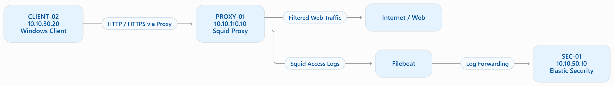
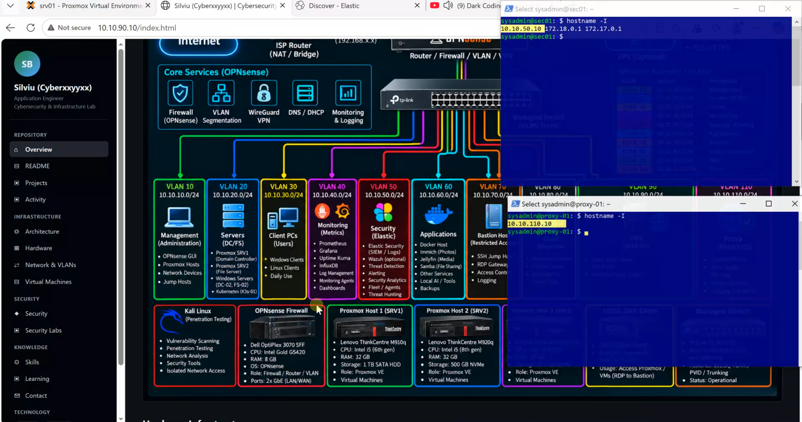
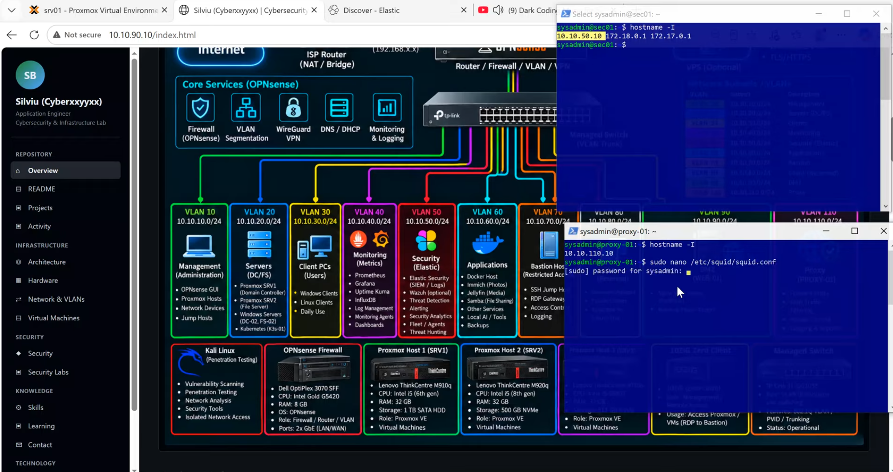
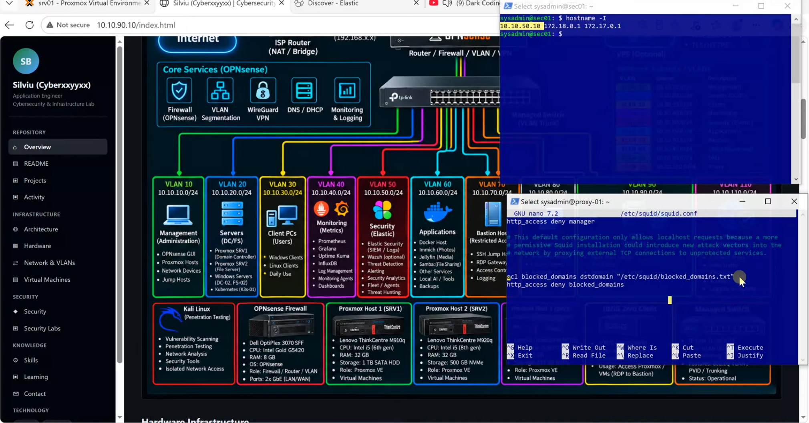
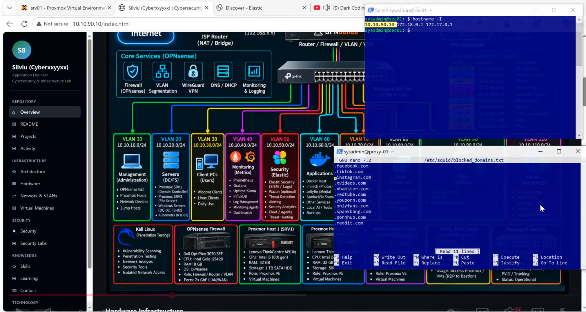

# Technical Documentation

## Squid Proxy & Elastic Security Integration

## 1. Lab Environment

The lab consists of three main systems operating in separate VLANs.

| Hostname | IP Address | Role | VLAN |
|---|---|---|---|
| CLIENT-02 | 10.10.30.20 | Windows Client | VLAN 30 |
| PROXY-01 | 10.10.110.10 | Ubuntu Server / Squid Proxy | VLAN 110 |
| SEC-01 | 10.10.50.10 | Elastic Security | VLAN 50 |

## 2. Architecture

The Windows client uses Squid Proxy to filter web traffic. Squid access logs are collected by Filebeat and forwarded to Elastic Security for monitoring and analysis.



### Traffic Flow

1. CLIENT-02 sends web requests through Squid Proxy.
2. Squid checks access control and domain filtering rules.
3. Allowed requests are forwarded to the Internet.
4. Squid generates access logs.
5. Filebeat collects and forwards the logs to Elastic Security.
6. Elastic Security provides visibility into web traffic and blocked requests.

## 3. Implementation Steps

### Step 1 – Squid Proxy Configuration

- Connect to the Ubuntu Proxy Server.



- Locate the Squid configuration file (`/etc/squid/squid.conf`).
- Open the file using Nano.
```bash
sudo nano /etc/squid/squid.conf
```




- Configure the listening port and Access Control Lists (ACL).
- Add the following lines into the configuration squid file
```bash
acl blocked_domains dstdomain "/etc/squid/blocked_domains.txt"
http_access deny blocked_domains
```



### Step 2 – Domain Blocklist

- Create a restricted domains list.
- Configure Squid to read the blocklist.
```bash
sudo nano /etc/squid/blocked_domains.txt
```


- Apply domain filtering rules.
```bash
sudo systemctl reload squid
```


## 3. Testing & Validation

- Before Applying ACL Rules - Test access to allowed websites. Access allowed websites through the proxy.
  

  
- After Applying ACL Rules - Attempt to access restricted domains. Access allowed websites through the proxy.


### Step 4 – Elastic Security Monitoring

- Verify incoming Squid events.
- 
  Filter by:
```bash
  event.dataset : "squid.log" and squid.status_code : 403
```


- Analyze blocked and allowed requests.


*This documentation describes a practical cybersecurity lab implemented in a controlled homelab environment.*
