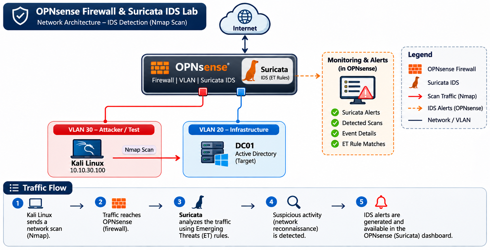
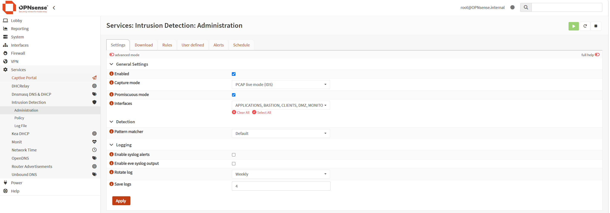
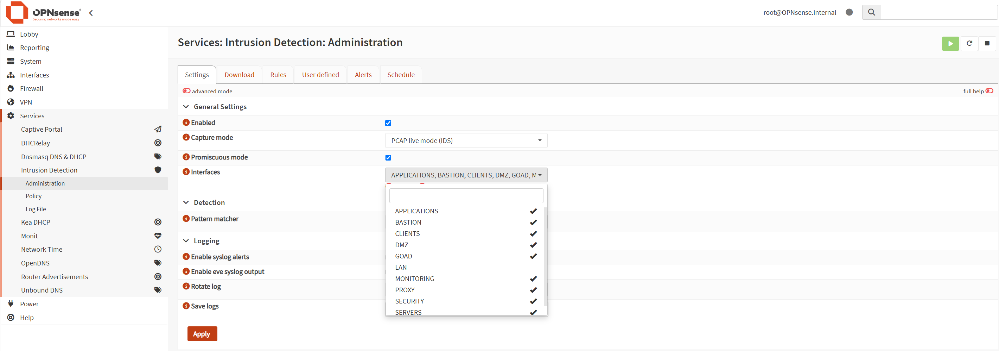

# Technical Documentation

## OPNsense Firewall & Suricata IDS

## Project Video

[Watch the project demonstration on YouTube](https://www.youtube.com/watch?v=VnaMIsNCiWA)

## 1. Lab Environment

The lab consists of the following systems operating in a segmented network environment.

| **Hostname / Component** | **IP Address** | **Role** | **VLAN** |
|---|---|---|---|
| OPNsense | 10.10.10.1 | Firewall / Network Security | VLAN 10 |
| Kali Linux | 10.10.30.100 | Network Scanning / Attack Simulation | VLAN 30 |
| DC01 | 10.10.20.10 | Windows Server / Active Directory | VLAN 20 |

## 2. Architecture

OPNsense provides network segmentation and traffic inspection. Suricata IDS monitors network traffic and uses Emerging Threats (ET) rules to detect suspicious activities, including network reconnaissance and Nmap scanning.

### Traffic Flow

1. Kali Linux generates network scanning traffic from VLAN 30.
2. Traffic is directed toward the Active Directory Domain Controller (DC01).
3. OPNsense inspects network traffic.
4. Suricata analyzes traffic using configured detection rules.
5. Emerging Threats rules identify suspicious network activity.
6. Suricata generates IDS alerts for further investigation.

## 3. Implementation Steps

### Step 1 – OPNsense Firewall Configuration

- Access the OPNsense web interface: **Services > Intrusion Detection > Administration > Settings**

  
- Review firewall configuration and network interfaces: **Capture mode - PCAP live mode (IDS), Interfaces - selected VLAN's**

  

### Step 2 – Suricata IDS Configuration

- Navigate to the Suricata plugin in OPNsense.
- Enable Suricata IDS.
- Configure the interface used for traffic inspection.
- Enable logging and alert generation.

### Step 3 – Emerging Threats Rules

- Enable the Emerging Threats (ET) ruleset.
- Download and update the available rules.
- Enable relevant rules for network scanning and reconnaissance detection.
- Apply the updated ruleset.

### Step 4 – Nmap Scan Simulation

- Use Kali Linux to generate network scanning traffic.
- Perform an Nmap scan from the simulated compromised client (`10.10.30.100`).
- Target the Active Directory Domain Controller (DC01).
- Generate reconnaissance traffic to test IDS detection capabilities.

### Step 5 – Suricata IDS Monitoring

- Access the Suricata alerts in OPNsense.
- Review events generated during the Nmap scan.
- Identify alerts related to network scanning and suspicious connection attempts.
- Analyze source and destination information, timestamps, and triggered rules.

## 4. Testing & Validation

- Generate Nmap scanning traffic from the simulated compromised client.
- Verify that Suricata detects suspicious network activity.
- Review the generated IDS alerts.
- Identify the triggered Emerging Threats rules.
- Confirm that the alerts correspond to the simulated scanning activity.

## 5. Security Event Analysis

Analyze the detected events to understand:

- Source and destination IP addresses.
- Targeted services and ports.
- Network reconnaissance patterns.
- Triggered Suricata signatures.
- Emerging Threats rule classifications.
- Event timestamps and alert severity.

*This documentation describes a practical intrusion detection lab implemented in a controlled homelab environment. The project demonstrates network scanning simulation, firewall traffic inspection, and IDS alert analysis.*
