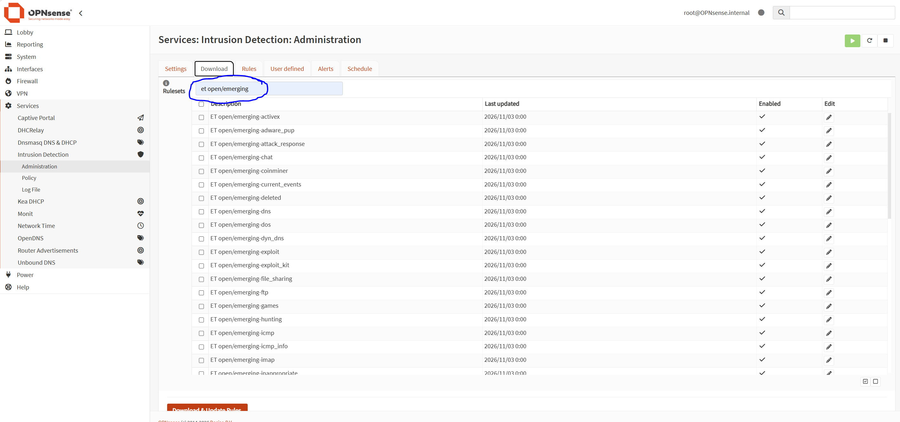
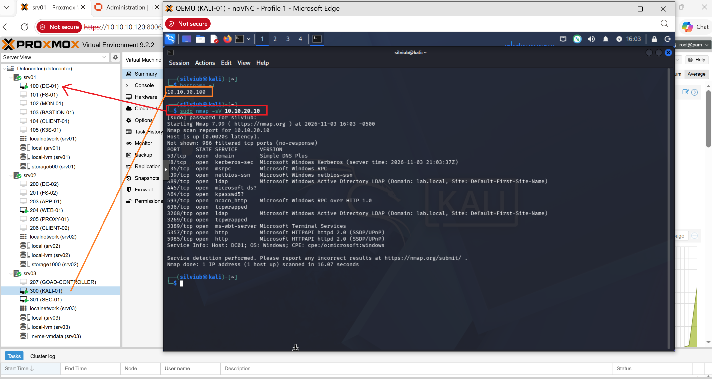
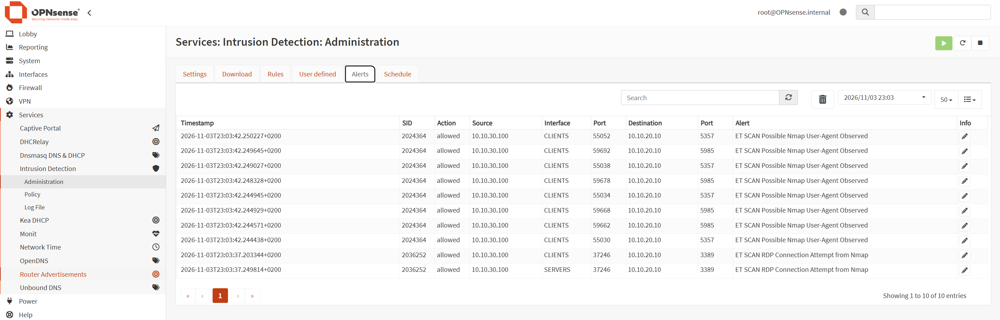

# Technical Documentation

## OPNsense Firewall & Suricata IDS

## Project Video

[Watch the project demonstration on YouTube](https://www.youtube.com/watch?v=VnaMIsNCiWA)

## 1. Lab Environment

The lab consists of the following systems operating in a segmented network environment.

| **Hostname / Component** | **IP Address** | **Role** | **VLAN** |
|---|---|---|---|
| OPNsense | 10.10.10.1 | Firewall / Network Security | VLAN 10 |
| Kali Linux | 10.10.30.100 | Network Scanning / Attack Simulation | VLAN 30 |
| DC01 | 10.10.20.10 | Windows Server / Active Directory | VLAN 20 |


## 2. Architecture

OPNsense provides network segmentation and traffic inspection. Suricata IDS monitors network traffic and uses Emerging Threats (ET) rules to detect suspicious activities, including network reconnaissance and Nmap scanning.


### Traffic Flow

1. Kali Linux generates network scanning traffic from VLAN 30.
2. Traffic is directed toward the Active Directory Domain Controller (DC01).
3. OPNsense inspects network traffic.
4. Suricata analyzes traffic using configured detection rules.
5. Emerging Threats rules identify suspicious network activity.
6. Suricata generates IDS alerts for further investigation.

## 3. Implementation Steps

### Step 1 – OPNsense Firewall Configuration

- Access the OPNsense web interface: **Services > Intrusion Detection > Administration > Settings**


- Enable Suricata IDS.
- Review firewall configuration and network interfaces: **Capture mode - PCAP live mode (IDS), Interfaces - selected VLAN's**

  - Enable Syslog allerts.

### Step 2 – Emerging Threats Rules

- Enable the Emerging Threats (ET) ruleset.
- Download and update the available rules.
- Enable relevant rules for network scanning and reconnaissance detection.
- Apply the updated ruleset.

  

### Step 3 – Nmap Scan Simulation

- Windows Server (DC-01: 10.10.20.10) > 
- Kali Linux (KALI-01: 10.10.30.100)
- Perform an Nmap scan from the simulated compromised client (`10.10.30.10/VLAN 30`).
- Target the Active Directory Domain Controller (DC01).
- Generate reconnaissance traffic to test IDS detection capabilities.

```bash
sudo nmap -sV 10.10.20.10
```
-sV: enables service version detection, identifying the services and their versions running on open ports

 

### Step 4 – Suricata IDS Monitoring

- Access the Suricata alerts in OPNsense.
- Review events generated during the Nmap scan.
- Identify alerts related to network scanning and suspicious connection attempts.
- Analyze source and destination information, timestamps, and triggered rules.

 

## 4. IDS Detection & Alert Analysis

A network scan was performed from Kali Linux (`10.10.30.100`) against the Active Directory Domain Controller (`10.10.20.10`) using Nmap with service version detection (`-sV`).

Suricata successfully detected suspicious scanning activity using Emerging Threats (ET) rules.

The generated alerts included:

- `ET SCAN Possible Nmap User-Agent Observed`
- `ET SCAN RDP Connection Attempt from Nmap`

The alerts provided visibility into the source IP, destination IP, network interface, destination ports, and triggered rule identifiers (SIDs).

The detected traffic was allowed, confirming that Suricata was operating in IDS detection mode rather than actively blocking the traffic.


*This documentation describes a practical intrusion detection lab implemented in a controlled homelab environment. The project demonstrates network scanning simulation, firewall traffic inspection, and IDS alert analysis.*
