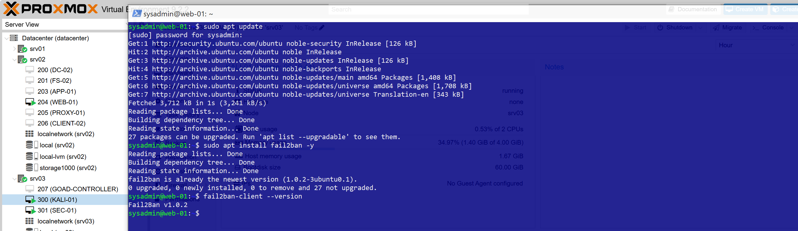
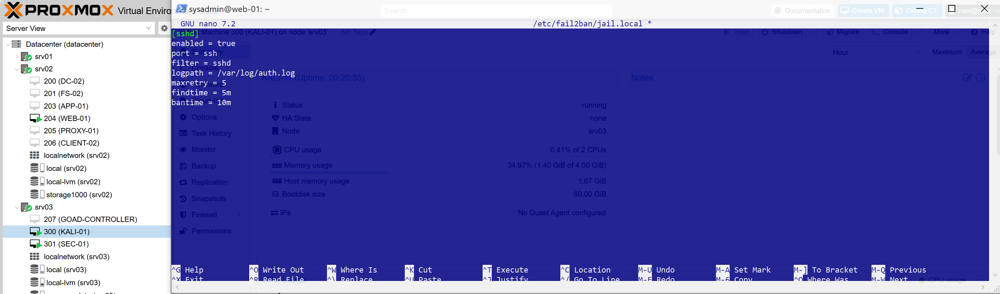
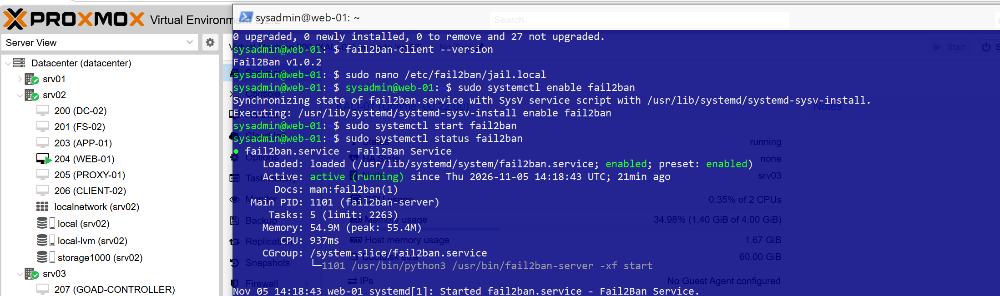
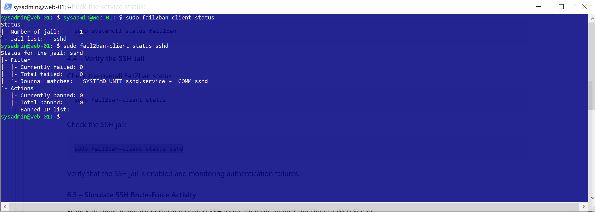
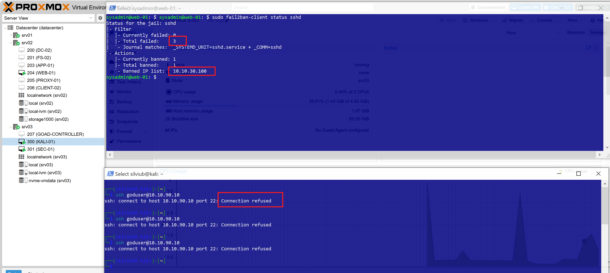

# Technical Documentation

## Elastic Security SIEM – SSH Brute-Force Detection & Response

## Project Video

[Watch the project demonstration on YouTube](https://www.youtube.com/watch?v=FaD-Q2_n-pM&t=218s)

[Watch the project demonstration on YouTube](https://www.youtube.com/watch?v=yNAqy7OPQF4&t=113s)

## 1. Lab Environment

The lab consists of three main systems operating in a segmented network environment.

| **Hostname / Component** | **IP Address** | **Role** | **VLAN** |
|---|---|---|---|
| KALI-01 | 10.10.30.100 | SSH Attack Simulation | VLAN 30 |
| WEB-01 | 10.10.90.10 | Ubuntu Linux Web Server / SSH Target | VLAN 90 |
| SEC-01 | 10.10.50.10 | Elastic Security SIEM | VLAN 50 |

## 2. Architecture

The Ubuntu Linux Web Server provides SSH access and generates authentication logs. Kali Linux is used to simulate repeated failed SSH authentication attempts.

Filebeat or Elastic Agent collects Linux authentication logs and forwards them to Elastic Security for monitoring, detection, and investigation.


### Traffic Flow

1. Kali Linux generates repeated SSH authentication attempts against the Ubuntu Web Server.
2. The Linux server records failed authentication attempts.
3. Filebeat / Elastic Agent collects authentication logs.
4. Logs are forwarded to Elastic Security.
5. Elasticsearch stores and processes incoming security events.
6. Elastic Security analyzes authentication activity using detection rules.
7. Security alerts are generated for suspicious SSH activity.
8. The detected activity is investigated and appropriate response actions are applied.

## 3. Implementation Steps

### Step 1 – Lab Environment Preparation
- The following demonstration was performed from the management laptop, connection to VM's via PowerShell.
- Access the Ubuntu Linux Web Server via PowerShell terminal.
- Access Kali Linux via PowerShell terminal.

```bash
ssh admin@10.10.30.100 # Example SSH connection to Kali
```
```bash
ssh admin@10.10.90.10 # Example SSH connection to the Web Server
```


### Step 2 – SSH Authentication Logging & Attack Simulation

**On WEB-01 (Ubuntu Linux Web Server):**

- Verify that the SSH service is running.
```bash
sudo systemctl status ssh
```


- Prepare the authentication log monitoring.
- Open the SSH authentication log for real-time monitoring.
```bash
sudo tail -f /var/log/auth.log
```


- Use Kali Linux to generate repeated SSH authentication failures.
- Target the Ubuntu Linux Web Server.
- Perform controlled authentication attempts using an invalid username or password.


- Three failed login attempts using the username admin and different passwords.


- Six failed login attempts using the username admin/superadmin and different passwords.


  
### Step 3 – Elastic Security Monitoring

- Access Discover in Kibana.
- Review incoming Linux authentication events.
- Identify failed SSH login attempts.
- Analyze source IP addresses and attempted usernames.
- Verify event timestamps and authentication results.
Example KQL filter:
```kql
host.name: "web-01" and message: "*Failed password*"
```


### SSH Authentication Event Analysis

The Discover interface was used to investigate failed SSH
authentication attempts originating from Kali Linux.

The analysis identified the source IP address, attempted
username, target hostname, and authentication timestamps.

## 4. Incident Response & Validation

The response process includes:

1. Identify suspicious SSH authentication activity.
2. Investigate the source IP address.
3. Review failed login events.
   


4. Create rule alert for brut force activities **Security > Rules > Detection Rules > Create a rule > KQL: host.name: "web-01" and message: "*Failed password*", treshhod >5 + rest of the details**
   


**Incident Response & Fail2ban Configuration**

Fail2ban is deployed on the Ubuntu Linux Web Server to provide automated protection against repeated SSH authentication failures.
The service monitors Linux authentication logs and automatically blocks source IP addresses that exceed the configured number of failed login attempts.

#### 4.1 – Install Fail2ban

Update the Ubuntu package repository:

```bash
sudo apt update
```

Install Fail2ban:

```bash
sudo apt install fail2ban -y
```

Verify the installed version:

```bash
fail2ban-client --version
```


#### 4.2 – Configure Fail2ban

Create a local configuration file:

```bash
sudo nano /etc/fail2ban/jail.local
```

Add the following SSH jail configuration:

```ini
[sshd]
enabled = true
port = ssh
filter = sshd
logpath = /var/log/auth.log
maxretry = 3
findtime = 5m
bantime = 10m
```

Configuration parameters:

| Parameter | Description |
|---|---|
| `enabled` | Enables SSH protection |
| `port` | Monitors the SSH service |
| `filter` | Uses the SSH authentication filter |
| `logpath` | Specifies the authentication log file |
| `maxretry` | Maximum number of failed attempts |
| `findtime` | Time window for counting failed attempts |
| `bantime` | Duration of the IP ban |




#### 4.3 – Enable and Start the Service

Enable Fail2ban at system startup:

```bash
sudo systemctl enable fail2ban
```

Start the service:

```bash
sudo systemctl start fail2ban
```

Restart the service to apply the configuration:

```bash
sudo systemctl restart fail2ban
```

Check the service status:

```bash
sudo systemctl status fail2ban
```

#### 4.4 – Verify the SSH Jail

Check the overall Fail2ban status:

```bash
sudo fail2ban-client status
```

Check the SSH jail:

```bash
sudo fail2ban-client status sshd
```

Verify that the SSH jail is enabled and monitoring authentication failures.


#### 4.5 – Simulate SSH Brute-Force Activity

From Kali Linux, manually perform repeated SSH login attempts against the Ubuntu Web Server:

```bash
ssh goduser@10.10.90.10
```
- Use different incorrect passwords to generate failed authentication events.
- No Hydra or other automated brute-force tools are used.
**- Validate Automatic IP Blocking**
- After exceeding the configured threshold of five failed attempts within five minutes, check the SSH jail status:
```bash
sudo fail2ban-client status sshd
```


- The connection should be blocked while the Fail2ban ban is active.
- This validates that Fail2ban has applied the configured host-level protection.



## 5. Conclusion

This demonstration confirms that Fail2ban can effectively mitigate SSH brute-force attempts by automatically detecting repeated failed authentication attempts and temporarily blocking the source IP address. After exceeding the configured threshold, the Kali Linux IP address was added to the SSH jail's banned IP list, preventing further SSH access during the ban period.

Combined with Elastic Security monitoring and alerting, this implementation demonstrates an effective approach to SSH brute-force detection, investigation, and host-level incident response in a controlled homelab environment.
