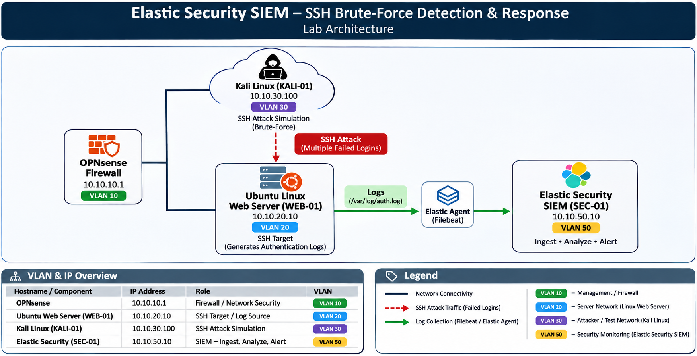
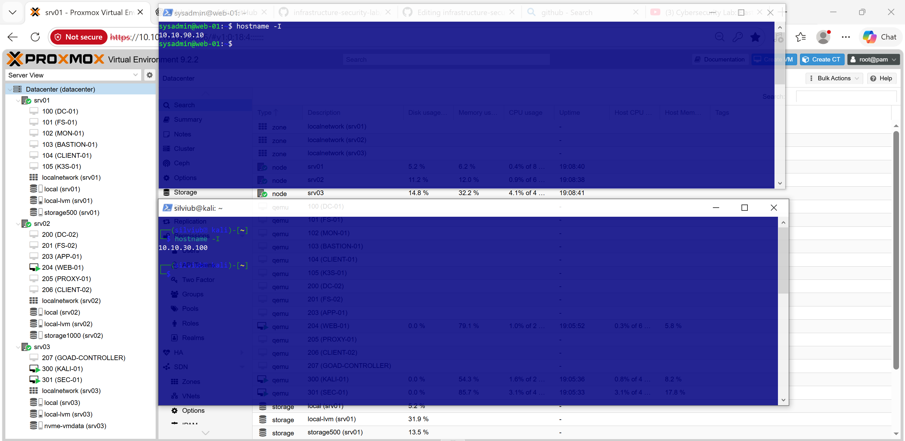
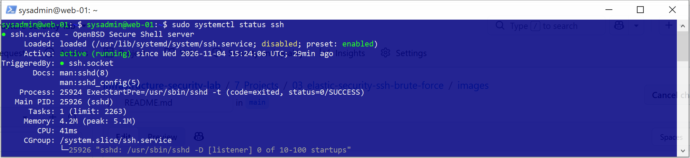
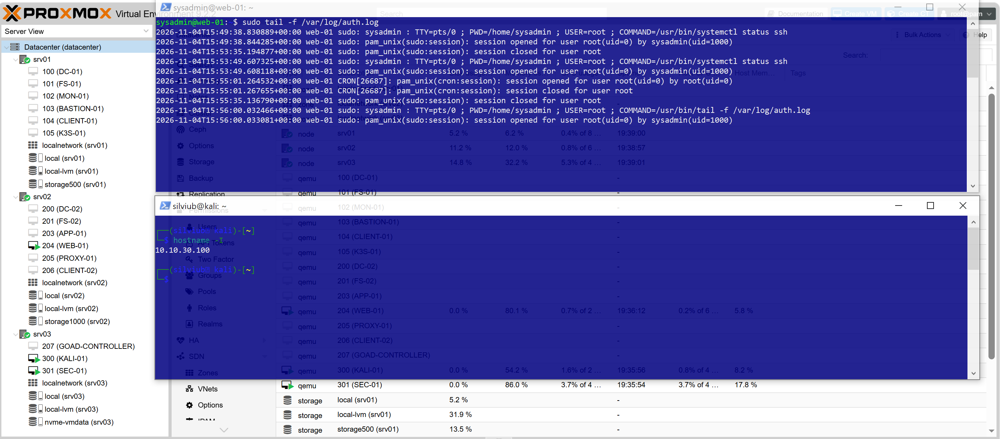
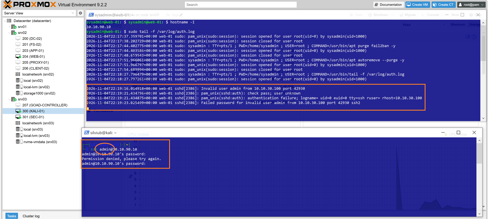
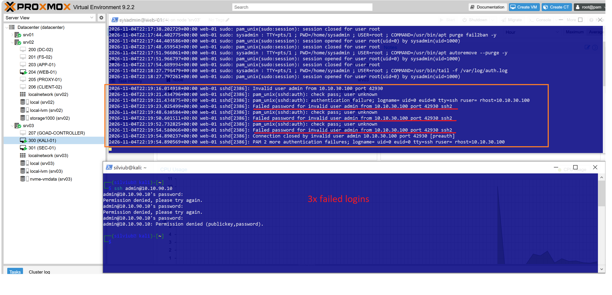
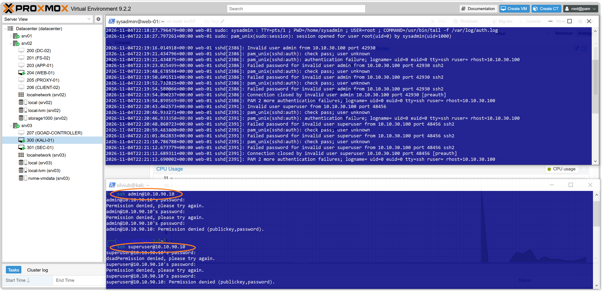
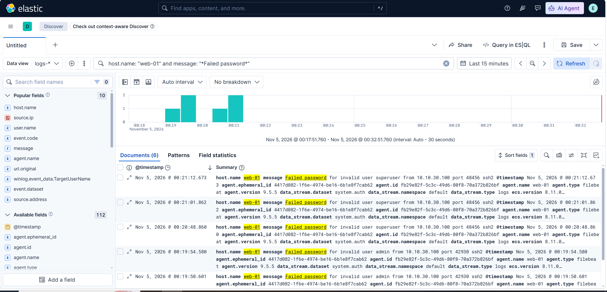
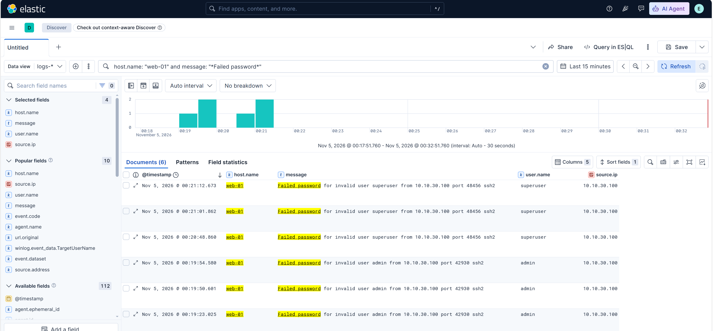

# Technical Documentation

## Elastic Security SIEM – SSH Brute-Force Detection & Response

## Project Video

[Watch the project demonstration on YouTube](https://www.youtube.com/watch?v=FaD-Q2_n-pM&t=218s)

## 1. Lab Environment

The lab consists of three main systems operating in a segmented network environment.

| **Hostname / Component** | **IP Address** | **Role** | **VLAN** |
|---|---|---|---|
| KALI-01 | 10.10.30.100 | SSH Attack Simulation | VLAN 30 |
| WEB-01 | 10.10.90.10 | Ubuntu Linux Web Server / SSH Target | VLAN 90 |
| SEC-01 | 10.10.50.10 | Elastic Security SIEM | VLAN 50 |

## 2. Architecture

The Ubuntu Linux Web Server provides SSH access and generates authentication logs. Kali Linux is used to simulate repeated failed SSH authentication attempts.

Filebeat or Elastic Agent collects Linux authentication logs and forwards them to Elastic Security for monitoring, detection, and investigation.



### Traffic Flow

1. Kali Linux generates repeated SSH authentication attempts against the Ubuntu Web Server.
2. The Linux server records failed authentication attempts.
3. Filebeat / Elastic Agent collects authentication logs.
4. Logs are forwarded to Elastic Security.
5. Elasticsearch stores and processes incoming security events.
6. Elastic Security analyzes authentication activity using detection rules.
7. Security alerts are generated for suspicious SSH activity.
8. The detected activity is investigated and appropriate response actions are applied.

## 3. Implementation Steps

### Step 1 – Lab Environment Preparation
.
- The following demonstration was performed from the management laptop, connection to VM's via PowerShell.
- Access the Ubuntu Linux Web Server via PowerShell terminal.
- Access Kali Linux via PowerShell terminal.

```bash
ssh admin@10.10.30.100 # Example SSH connection to Kali
```
```bash
ssh admin@10.10.90.10 # Example SSH connection to the Web Server
```



### Step 2 – SSH Authentication Logging & Attack Simulation

**On WEB-01 (Ubuntu Linux Web Server):**

- Verify that the SSH service is running.
```bash
sudo systemctl status ssh
```


- Prepare the authentication log monitoring.
- Open the SSH authentication log for real-time monitoring.
```bash
sudo tail -f /var/log/auth.log
```


- Use Kali Linux to generate repeated SSH authentication failures.
- Target the Ubuntu Linux Web Server.
- Perform controlled authentication attempts using an invalid username or password.



- Three failed login attempts using the username admin and different passwords.



- Six failed login attempts using the username admin and different passwords.


  
### Step 3 – Elastic Security Monitoring

- Access Discover in Kibana.
- Review incoming Linux authentication events.
- Identify failed SSH login attempts.
Example KQL filter:
```kql
host.name: "web-01" and message: "*Failed password*"
```

  
- Analyze source IP addresses and attempted usernames.
- Verify event timestamps and authentication results.




### Step 6 – Incident Response

- Investigate the source IP address.
- Review the affected Linux account.
- Analyze authentication events.
- Configure Fail2ban or firewall-based IP blocking.
- Verify that suspicious SSH access attempts are mitigated.
- Monitor subsequent authentication activity.

Example Fail2ban service check:

```bash
sudo systemctl status fail2ban
```

## 4. SSH Brute-Force Detection & Alert Analysis

Repeated failed SSH authentication attempts are generated from Kali Linux against the Ubuntu Linux Web Server.

Elastic Security receives authentication events collected from the Linux server and analyzes them to identify suspicious login activity.

The investigation focuses on:

- Source IP address.
- Target hostname.
- Attempted usernames.
- Number of failed authentication attempts.
- Authentication timestamps.
- Detection rule and alert details.

The objective is to identify potential brute-force activity and investigate unauthorized SSH access attempts.

## 5. Incident Response & Validation

The response process includes:

1. Identify suspicious SSH authentication activity.
2. Investigate the source IP address.
3. Review failed login events.
4. Apply blocking measures using Fail2ban or firewall rules.
5. Verify that the source IP is blocked.
6. Confirm that subsequent SSH access attempts are mitigated.

## 6. Proof of Evidence

Screenshots documenting the Linux server configuration, SSH attack simulation, authentication logs, Elastic Security events, detection alerts, and incident response actions are included in the `images/` directory.

Detailed configuration steps, implementation screenshots, testing results and technical evidence are documented in this file.

---

*This documentation describes a practical SSH brute-force detection and response lab implemented in a controlled homelab environment.*
