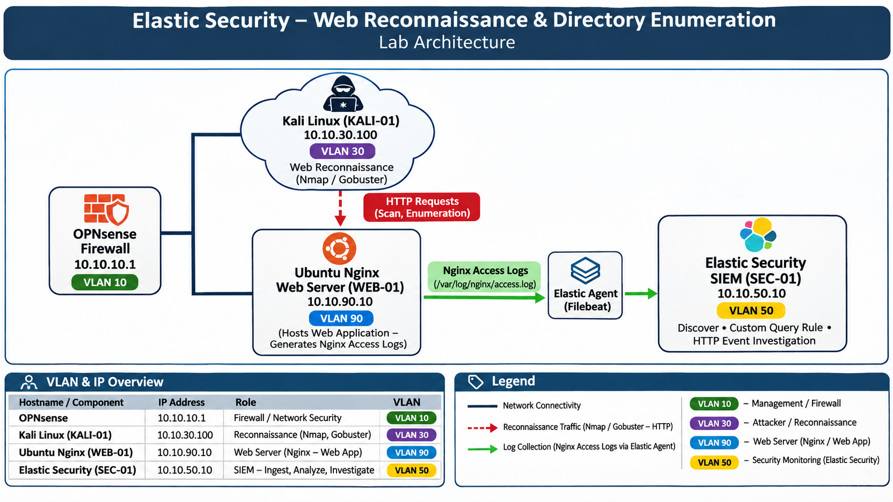

# Technical Documentation

## Elastic Security SIEM – Web Reconnaissance & Directory Enumeration

## Project Video

[Watch the project demonstration on YouTube](https://www.youtube.com/watch?v=thgz7f_rJy0)

## 1. Lab Environment

The lab consists of three main systems operating in a segmented network environment.

| **Hostname / Component** | **IP Address** | **Role** | **VLAN** |
|---|---|---|---|
| KALI-01 | 10.10.30.100 | Network Reconnaissance / Directory Enumeration | VLAN 30 |
| WEB-01 | 10.10.90.10 | Ubuntu Linux Web Server / Nginx | VLAN 90 |
| SEC-01 | 10.10.50.10 | Elastic Security SIEM | VLAN 50 |

## 2. Architecture

The Ubuntu Linux Web Server hosts an Nginx web server and records incoming HTTP requests in its access logs.

Kali Linux is used to perform network reconnaissance using Nmap and web directory enumeration using Gobuster.

Nginx access logs are collected and forwarded to Elastic Security for centralized monitoring and investigation.


### Traffic Flow

1. Kali Linux performs network reconnaissance against the Ubuntu Web Server using Nmap.
2. Nmap identifies exposed services and service versions.
3. Gobuster performs web directory enumeration against the Nginx Web Server.
4. The generated HTTP requests are recorded in Nginx access logs.
5. Log collection forwards Nginx access events to Elastic Security.
6. Elasticsearch stores and processes incoming web access events.
7. A custom Elastic Security query rule monitors Nginx access events.
8. The collected HTTP activity is investigated using Kibana Discover.

### Network Architecture Diagram

The following diagram illustrates the lab architecture, network segmentation, reconnaissance traffic flow, and centralized Nginx log monitoring.



## 3. Implementation Steps

### Step 1 – Lab Environment Preparation

- The demonstration was performed from the management laptop.
- Access Kali Linux through the management environment.
- Access the Ubuntu Linux Web Server.
- Verify network connectivity between the testing machine and the target web server.

**Access Kali Linux:**

```bash
ssh admin@10.10.30.100
```

**Access Ubuntu Web Server:**

```bash
ssh admin@10.10.90.10
```

### Step 2 – Network Reconnaissance & Service Discovery

**On KALI-01 (Kali Linux):**

- Perform network reconnaissance against WEB-01.
- Identify exposed ports and running services.
- Use Nmap service version detection to identify available services.

Execute the following command:

```bash
sudo nmap -sV 10.10.90.10
```

The `-sV` option enables service version detection.

**Observed results:**

| Port | State | Service | Version |
|---|---|---|---|
| 22/tcp | Open | SSH | OpenSSH 9.6p1 |
| 80/tcp | Open | HTTP | Nginx |
| 443/tcp | Closed | HTTPS | Not available |

The scan identified SSH and HTTP services running on the target server.


### Step 3 – Web Directory Enumeration

After identifying the HTTP service, Gobuster was used to perform directory enumeration against the Nginx Web Server.

Execute the following command from Kali Linux:

```bash
gobuster dir -u http://10.10.90.10 \
-w /usr/share/wordlists/dirb/common.txt
```

Command parameters:

- `dir` – directory enumeration mode.
- `-u` – target web server URL.
- `-w` – wordlist used for directory discovery.

Gobuster generates HTTP requests using entries from the selected wordlist to identify potentially accessible directories and web resources.

The enumeration activity generates HTTP traffic that can be investigated through the Nginx access logs.

### Step 4 – Nginx Access Log Monitoring

**On WEB-01 (Ubuntu Linux Web Server):**

- Monitor incoming HTTP requests.
- Review requests generated during Nmap scanning and Gobuster enumeration.
- Identify the source IP address and requested web paths.
- Analyze HTTP response status codes.

Open the Nginx access log for real-time monitoring:

```bash
sudo tail -f /var/log/nginx/access.log
```

During the reconnaissance activity, HTTP requests originating from Kali Linux (`10.10.30.100`) were visible in the Nginx access logs.

Observed activity included:

- HTTP GET requests.
- HTTP POST requests.
- Requests to the web server root path.
- Requests to additional web paths.
- HTTP response codes such as `200` and `404`.
- User-Agent information associated with Nmap scripting activity.


### Step 5 – Elastic Security Log Monitoring

- Access Kibana.
- Navigate to Discover.
- Review incoming Nginx access events.
- Identify HTTP requests originating from Kali Linux.
- Analyze requested URLs and response status codes.
- Verify the target hostname and event timestamps.

The following KQL query was used to filter Nginx access events from WEB-01:

```kql
host.name : "web-01" and event.dataset : "nginx.access"
```

The query filters events associated with the WEB-01 hostname and the Nginx access dataset.


### Step 6 – Custom Elastic Security Detection Rule

A custom query rule was configured in Elastic Security to monitor Nginx access events generated by WEB-01.

**Rule configuration:**

- Navigate to **Security → Rules → Detection Rules**.
- Select **Create a rule**.
- Choose **Custom Query**.
- Configure the following KQL query:

```kql
host.name : "web-01" and event.dataset : "nginx.access"
```

**Additional configuration:**

| Parameter | Configuration |
|---|---|
| Rule type | Custom Query |
| Hostname | `web-01` |
| Event dataset | `nginx.access` |
| Query language | KQL |
| Alert suppression field | `source.ip` |
| Alert suppression | Per rule execution |

The `source.ip` field is configured for alert suppression to reduce repeated alerts from the same source IP address.


### Web Reconnaissance Event Analysis

The Elastic Discover interface was used to investigate Nginx access events generated during the reconnaissance and directory enumeration activities.

The investigation focused on:

- Source IP address.
- Target hostname.
- Requested URLs and directories.
- HTTP request methods.
- HTTP response status codes.
- User-Agent information.
- Event timestamps.

The analysis provides visibility into HTTP activity originating from Kali Linux and allows investigation of the requests recorded by the Nginx Web Server.

## 4. Security Monitoring & Investigation

The monitoring process focuses on identifying and investigating web activity generated during network reconnaissance and directory enumeration.

The investigation includes:

1. Identify the source IP address performing reconnaissance.
2. Review Nmap service discovery results.
3. Analyze HTTP requests generated during Gobuster enumeration.
4. Review Nginx access logs.
5. Investigate HTTP events in Elastic Discover.
6. Review the custom Elastic Security query rule configuration.
7. Analyze requested paths and HTTP response status codes.

The objective is to demonstrate how web server logs can provide visibility into reconnaissance activity and how Elastic Security can be used for centralized event investigation.

## 5. Conclusion

This demonstration confirms that network reconnaissance and web directory enumeration generate observable HTTP activity on the target web server.

Nmap was used to identify exposed services, while Gobuster generated HTTP requests during directory enumeration. Nginx recorded the incoming requests, and Elastic Security provided centralized visibility through log collection, custom query configuration, and event investigation.

The project demonstrates a practical workflow for web reconnaissance monitoring and SIEM-based security investigation in a controlled homelab environment.

---

*This documentation describes a practical web reconnaissance and security monitoring lab implemented in a controlled homelab environment for educational and cybersecurity portfolio purposes.*
