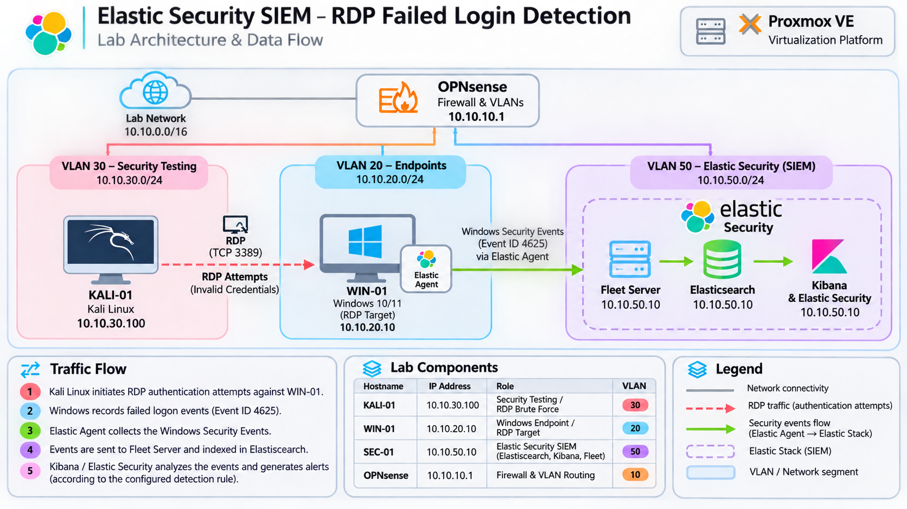
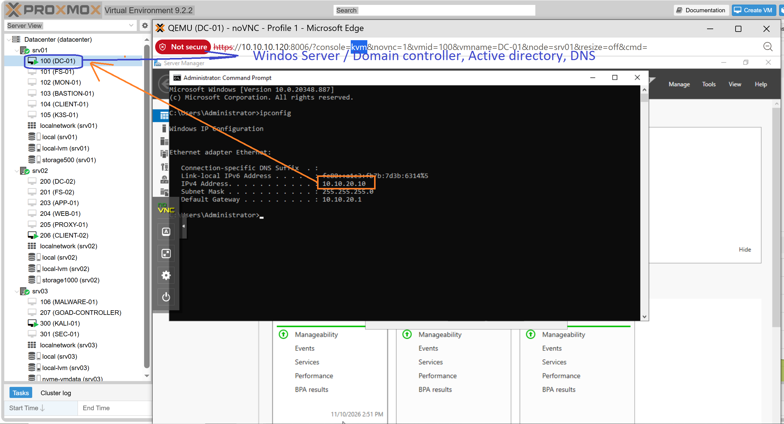
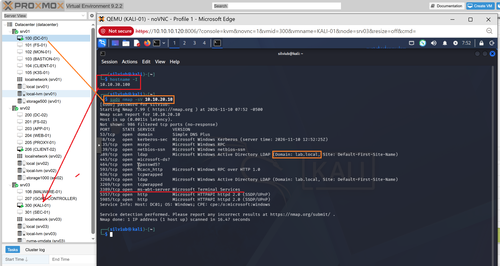
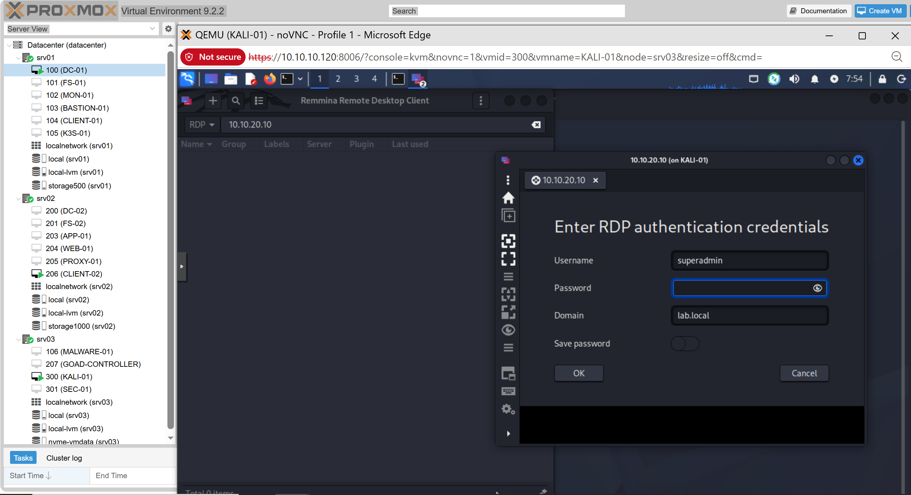
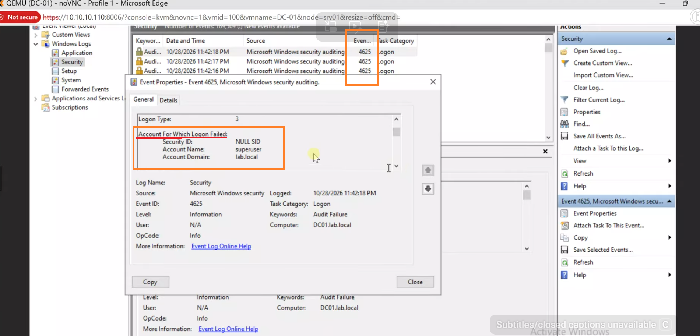

# Technical Documentation

## Elastic Security SIEM – Security Event Monitoring & RDP Failed Login Detection

### Project Video

[Watch the project demonstration on YouTube](https://www.youtube.com/watch?v=cfCilGGANMQ&t=188s)

---

## 1. Lab Environment

The lab consists of three main systems operating in a segmented network environment.

| Hostname / Component | IP Address | Role | VLAN |
|---|---|---|---|
| KALI-01 | 10.10.30.100 | Network Reconnaissance / RDP Authentication Testing | VLAN 30 |
| WINDOWS-CLIENT | 10.10.20.10 | Windows Endpoint / RDP Target | VLAN 20 |
| SEC-01 | 10.10.50.10 | Elastic Security SIEM | VLAN 50 |

The environment is hosted on Proxmox VE and uses OPNsense for network segmentation and traffic management.

## 2. Architecture

The project starts with a known target IP address belonging to the Windows endpoint.

Kali Linux is used to perform network reconnaissance against the target system using Nmap to identify exposed ports and running services.

After discovering the Remote Desktop Protocol (RDP) service on TCP port `3389`, controlled RDP authentication attempts are performed against the Windows endpoint.

Failed authentication attempts are recorded in the Windows Security Event Log, including Event ID `4625`.

Elastic Agent collects the relevant Windows Security Events and forwards them to the Elastic Stack infrastructure for centralized monitoring and investigation.

Elastic Security is used to analyze authentication activity, configure detection rules, and generate SIEM alerts.



### Traffic Flow

1. The target Windows endpoint IP address is identified as the initial reconnaissance target.
2. Kali Linux performs network reconnaissance using Nmap.
3. Nmap identifies exposed services and discovers RDP running on TCP port `3389`.
4. Kali Linux initiates controlled RDP authentication attempts against the Windows endpoint.
5. Windows records failed authentication attempts in the Security Event Log.
6. Windows generates Event ID `4625` for failed logon attempts.
7. Elastic Agent collects the relevant Windows Security Events.
8. Collected events are forwarded to the Elastic Stack.
9. Elasticsearch stores and indexes incoming security events.
10. Kibana Discover is used to investigate authentication events, while Elastic Security evaluates the configured detection rule and generates alerts when its conditions are met.

---

## 3. Implementation Steps

### Step 1 – Lab Environment Preparation

The demonstration was performed from the management laptop via Proxmox.

- Identify the Windows endpoint IP address.




The Windows endpoint used as the reconnaissance target:

```text
10.10.20.10
```

### Step 2 – Network Reconnaissance & Service Discovery

After identifying the target IP address, Nmap was used from Kali Linux to discover exposed network services.

Execute the following command:

```bash
sudo nmap -sV 10.10.20.10
```

The `-sV` option enables service version detection.

The scan helps identify:

- Open network ports.
- Available services.
- Service versions.
- Potential remote access services.

Pay particular attention to TCP port `3389`, commonly used by Remote Desktop Protocol (RDP).

An open RDP port indicates that the service is reachable from the scanning host.

The discovery of RDP provides the basis for the next testing stage.



- Nmap identified the target as a Windows Domain Controller belonging to the lab.local Active Directory domain.
- The scan revealed several Active Directory services, including DNS (53), Kerberos (88), LDAP (389, 3268) and SMB (445).
- RDP was also discovered running on TCP port 3389, confirming that the Remote Desktop service is exposed on the target system.
  
### Step 3 – RDP Authentication Testing

After identifying the RDP service, Remmina was used from Kali Linux to initiate Remote Desktop connections against the Windows endpoint.

The testing focused on Remote Desktop authentication using the following target:

```text
Target IP: 10.10.20.10
Protocol: RDP
Port: 3389
Username: superuser
```

Multiple authentication attempts were performed using the username `superuser` and different passwords, resulting in failed login attempts.

The objective was to generate Windows authentication failure events (Event ID `4625`) that could subsequently be collected and investigated in Elastic Security.



### Step 4 – Windows Security Event Monitoring

On the Windows endpoint, open Event Viewer.

Navigate to:

```text
Windows Logs → Security
```

Filter or search for Event ID:

```text
4625
```

Windows Security Event ID `4625` represents a failed logon attempt.

Review the generated events and investigate the following information:

- Account Name
- Source Network Address
- Logon Type
- Failure Information
- Event Timestamp

Verify that the recorded events correspond to the authentication attempts performed from Kali Linux.



### Step 5 – Elastic Security Event Collection

Access Kibana and navigate to Discover.

Verify that Windows Security Events are being received from the monitored endpoint.

Review the incoming authentication events and identify Event ID `4625`.

The following KQL query can be used to filter failed Windows logon events:

```kql
host.name : "WINDOWS-CLIENT" and event.code : "4625"
```

Investigate relevant fields, including:

- `host.name`
- `source.ip`
- `user.name`
- `event.code`
- `event.outcome`
- `winlog.event_data.LogonType`
- `@timestamp`

The analysis provides visibility into failed authentication attempts and helps correlate the generated events with the RDP testing activity.

### Step 6 – Elastic Security Detection Rule

A custom detection rule was configured in Elastic Security to monitor failed Windows authentication events.

Navigate to:

```text
Security → Rules → Detection Rules
```

Select:

```text
Create a rule → Custom Query
```

Configure the following KQL query:

```kql
host.name : "WINDOWS-CLIENT" and event.code : "4625"
```

Rule configuration:

| Parameter | Configuration |
|---|---|
| Rule type | Custom Query |
| Hostname | WINDOWS-CLIENT |
| Event code | 4625 |
| Query language | KQL |
| Detection source | Windows Security Events |

The rule monitors failed logon events generated by the selected Windows endpoint.

Review the rule configuration, execution interval, and alert settings.

After saving the rule, perform additional controlled failed authentication attempts and verify whether Elastic Security generates the expected alerts.

---

## 4. Security Monitoring & Investigation

The investigation follows the complete workflow, from network reconnaissance to SIEM alert analysis.

The monitoring and investigation process includes:

- Identifying the target system IP address.
- Performing network reconnaissance using Nmap.
- Discovering the exposed RDP service on TCP port `3389`.
- Performing controlled RDP authentication attempts.
- Identifying failed Windows logon events.
- Investigating Windows Event ID `4625`.
- Identifying the source IP address.
- Reviewing targeted usernames.
- Analyzing authentication timestamps.
- Examining Windows logon types and failure information.
- Reviewing Elastic Security detection alerts.

Elastic Security provides centralized visibility into the collected authentication events and supports investigation through event details and alert information.

This workflow demonstrates how network reconnaissance and endpoint authentication monitoring can be combined with SIEM-based detection and investigation.

---

## 5. Conclusion

This project demonstrates a practical security monitoring workflow using Nmap, Windows Security Event Logs, and Elastic Security SIEM in a controlled homelab environment.

The process begins with a known Windows endpoint IP address. Nmap is used to perform network reconnaissance and identify the exposed Remote Desktop Protocol service on TCP port `3389`.

Following service discovery, controlled RDP authentication attempts are performed to generate failed logon events on the Windows endpoint.

Windows Security Event ID `4625` provides the authentication failure information, while Elastic Agent collects and forwards the events to the Elastic Stack.

Kibana Discover enables centralized event analysis, and a custom Elastic Security detection rule monitors failed authentication activity and generates SIEM alerts when the configured conditions are met.

The project demonstrates an end-to-end security monitoring workflow, covering:

- Network reconnaissance and service discovery.
- RDP authentication testing.
- Windows security event collection.
- SIEM event analysis.
- Custom detection rule configuration.
- Security alert generation and investigation.

This documentation describes a practical SIEM monitoring and authentication detection lab implemented in a controlled homelab environment for educational and cybersecurity portfolio purposes.
