# Technical Documentation

## Malware Behaviour Analysis & C2 Simulation – Endpoint Monitoring, SIEM Detection & Network Forensics

## 1. Lab Environment

The lab consists of three main systems operating in a segmented network environment.

| **Hostname / Component** | **IP Address** | **Role** | **VLAN** |
|---|---|---|---|
| CLIENT-02 | 10.10.30.20 | Windows Endpoint / Malware Behaviour Simulation | VLAN 30 |
| MALWARE-01 | 10.10.120.10 | Ubuntu Server / C2 Simulation Server | VLAN 120 |
| SEC-01 | 10.10.50.10 | Elastic Security SIEM | VLAN 50 |
| OPNsense | Lab Gateway | Firewall / Network Segmentation / Packet Capture | Multiple VLANs |

The environment is hosted on Proxmox VE 9.2.2 and uses OPNsense for network segmentation and traffic monitoring.

The Windows endpoint is used to execute the custom-built simulation agent. The Ubuntu server hosts the heartbeat receiver, monitoring dashboard, and download portal.

Elastic Security is used for centralized event monitoring and investigation, while Wireshark provides packet-level network analysis.


## 2. Architecture

The project uses a custom-built Windows executable to simulate selected behaviours commonly associated with malware activity.

The Windows endpoint CLIENT-02 downloads and executes the agent from the Ubuntu simulation server MALWARE-01.

Following execution, the agent performs system information discovery, creates a local inventory file, modifies a dedicated Windows Registry key, and initiates periodic HTTP heartbeat communication with the simulation server.

The Ubuntu server uses Nginx as a web server and reverse proxy, while a Python Flask application receives heartbeat messages and stores endpoint information in an SQLite database.

A monitoring dashboard provides visibility into registered endpoints, online/offline status, heartbeat counts, and recent activity.

Windows Sysmon records process creation and network connection events. Elastic Agent and Filebeat collect relevant endpoint telemetry and forward it to Elastic Security for monitoring and investigation.

OPNsense is used to capture network traffic from the client VLAN. The exported PCAP file is then analyzed using Wireshark to inspect HTTP requests, responses, and periodic communication patterns.

### Traffic Flow

1. CLIENT-02 accesses the download portal hosted on MALWARE-01.
2. The Windows simulation agent is downloaded to the endpoint.
3. The executable is launched on CLIENT-02.
4. The agent collects basic system information.
5. A local system inventory file is created.
6. A dedicated Windows Registry key is created or updated.
7. The agent initiates periodic HTTP POST heartbeat communication.
8. MALWARE-01 receives and stores the heartbeat messages.
9. The monitoring dashboard displays endpoint activity.
10. Windows Sysmon records process creation and network connection events.
11. Elastic Agent / Filebeat collects relevant endpoint telemetry.
12. Elastic Security evaluates the collected events using a custom detection rule.
13. OPNsense captures network traffic generated by CLIENT-02.
14. Wireshark is used to inspect the exported PCAP file and analyze the HTTP communication.

## 3. Implementation Steps

### Step 1 – Lab Environment Preparation

The demonstration was performed using the virtualized infrastructure hosted on Proxmox VE.

The following virtual machines were used during the project:

| **VM ID** | **Hostname** | **Role** | **IP Address** |
|---|---|---|---|
| 106 | MALWARE-01 | Ubuntu Simulation Server | 10.10.120.10 |
| 206 | CLIENT-02 | Windows Test Endpoint | 10.10.30.20 |
| 301 | SEC-01 | Elastic Security | 10.10.50.10 |

The Windows endpoint and simulation server operate in separate network segments.

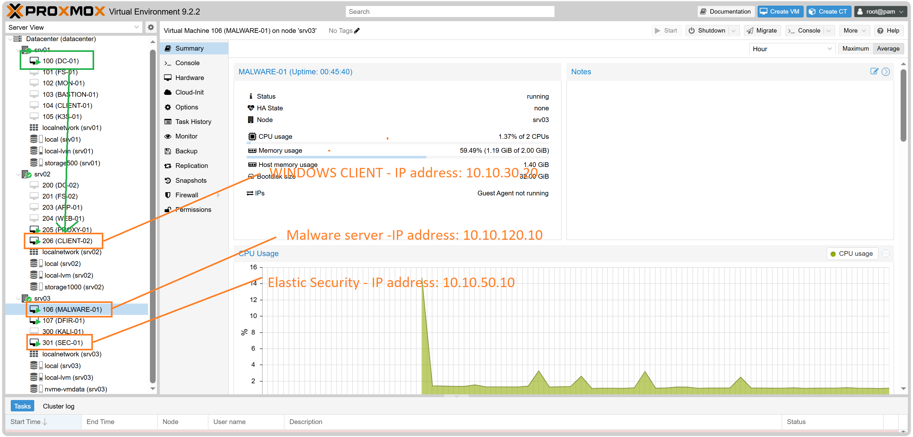

### Step 2 – Monitoring Server & Download Portal

On MALWARE-01, I configured the web-based download portal used to distribute the simulation agent.

The portal is accessible from CLIENT-02 using:

```text
http://10.10.120.10/download/
```

The download portal provides two agent versions:

- Python agent (`.py`) for systems with Python installed.
- Standalone Windows executable (`.exe`) that does not require a separate Python installation.

The Windows executable used in this demonstration is:

```text
CyberLab-Heartbeat-Agent.exe
```


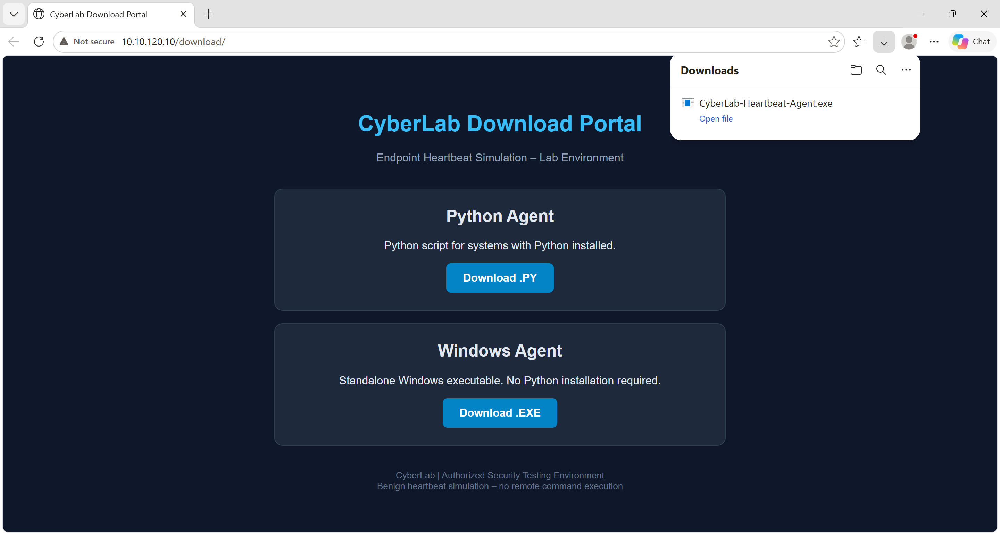

Before executing the agent, I checked the monitoring dashboard to verify that no endpoint was registered.

The dashboard displays the following information:

- Registered endpoints.
- Online endpoints.
- Offline endpoints.
- Total heartbeats.
- Connected hosts.
- Recent endpoint activity.

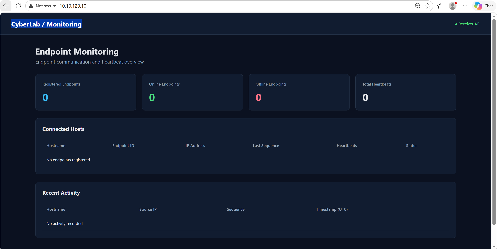

### Step 3 – Windows Agent Execution

On CLIENT-02, I downloaded the standalone Windows executable from the CyberLab download portal.

The executable was launched manually from the Windows Downloads directory.

```text
C:\Users\CLIENT-02\Downloads\CyberLab-Heartbeat-Agent.exe
```

The agent displays its simulation information, including:

- Endpoint hostname.
- Endpoint ID.
- C2 simulation server address.
- Heartbeat URL.
- Configured beacon interval.

The configured communication interval is 30 seconds.

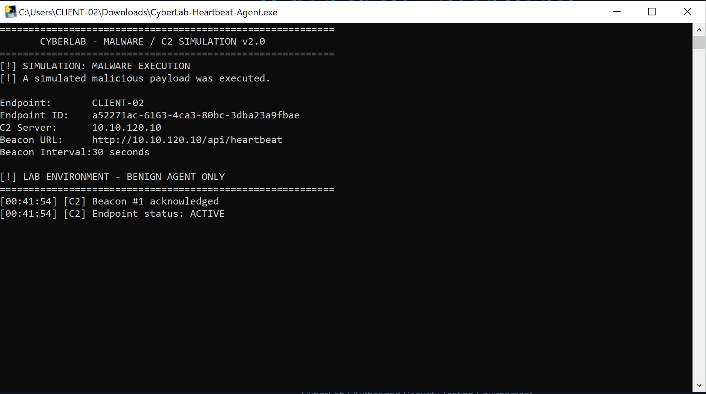

After execution, the agent initiated its first heartbeat communication with MALWARE-01.

The server acknowledged the communication and reported the endpoint as active.


### Step 4 – Endpoint Registration & Heartbeat Validation

After the first successful communication, I accessed the monitoring dashboard on MALWARE-01.

The dashboard confirmed that CLIENT-02 had been registered successfully.

The displayed information included:

| **Parameter** | **Observed Value** |
|---|---|
| Hostname | CLIENT-02 |
| Endpoint IP | 10.10.30.20 |
| Endpoint ID | a52271ac-6163-4ca3-80bc-3dba23a9fbae |
| Registered Endpoints | 1 |
| Online Endpoints | 1 |
| Offline Endpoints | 0 |
| Total Heartbeats | 2 |

The dashboard also displayed the heartbeat sequence numbers and timestamps.

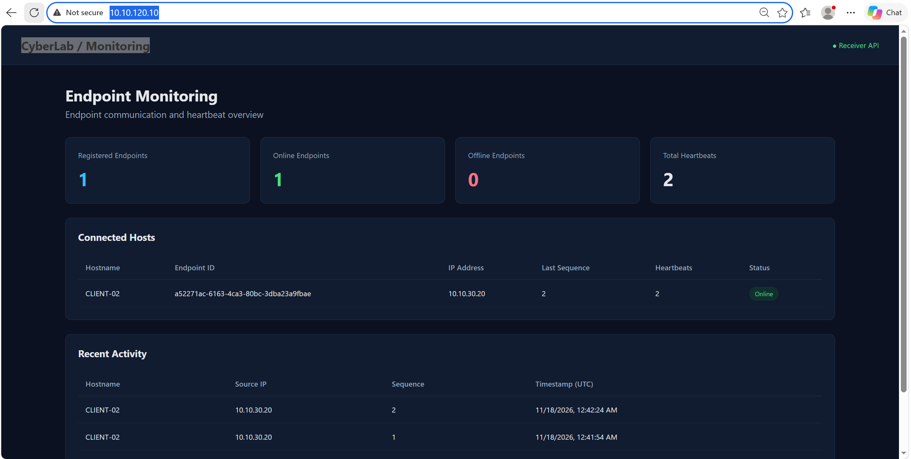

### Step 5 – Elastic Security Alert Investigation

After executing the CyberLab Heartbeat Agent on CLIENT-02, I accessed Elastic Security to review the alert generated by the custom detection rule.

The alert was associated with outbound network activity generated by:

```text
CyberLab-Heartbeat-Agent.exe
```

I opened the alert to investigate the available information and identify the source and destination of the network connection.

The alert contained the following details:

| **Parameter** | **Value** |
|---|---|
| Hostname | client-02 |
| Source IP | 10.10.30.20 |
| Destination IP | 10.10.120.10 |
| Destination Port | 80 |
| Event Dataset | windows.sysmon_operational |
| Risk Score | 47 |
| Severity | Medium |

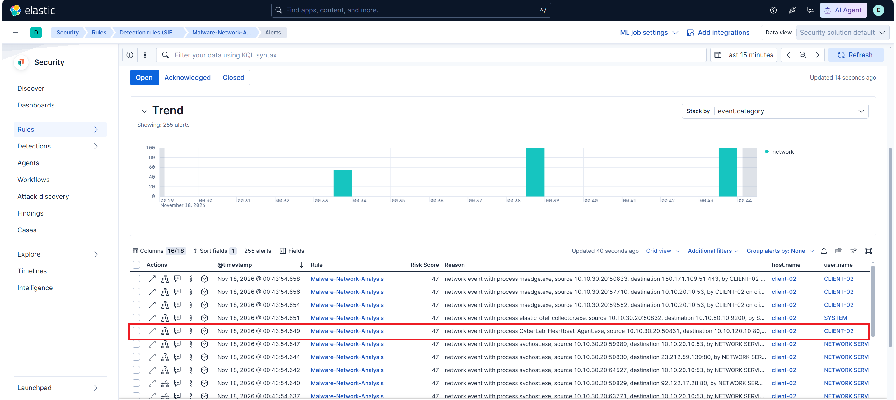

I then opened the alert details to review the process information and network connection metadata.

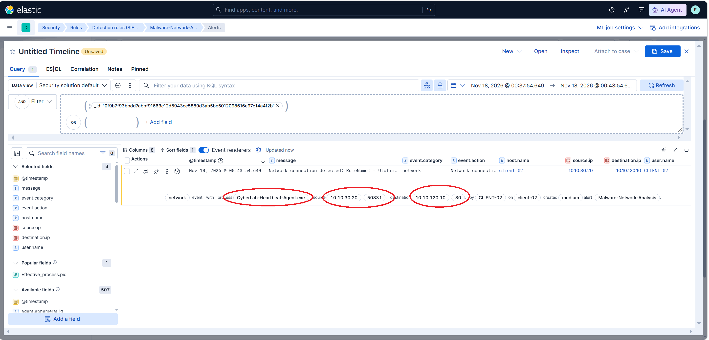

**Custom Detection Rule**

The alert was generated by a custom detection rule configured in Elastic Security.

I used the following KQL query:

```kql
event.dataset : "windows.sysmon_operational" and
event.code : "3" and
network.direction : "egress" and
destination.ip : *
```

The query identifies outbound network connection events (Sysmon Event ID 3) collected from Windows endpoints.

The rule detects network activity that matches the configured conditions. It does not independently classify the executable as malware.

After reviewing the alert, I continued the investigation on CLIENT-02 using Windows Event Viewer to validate the process execution and network connection at the endpoint level.

### Step 6 – Windows Sysmon Event Investigation

After identifying the network activity in Elastic Security, I accessed Windows Event Viewer on CLIENT-02 to investigate the underlying Sysmon events.

Navigate to:

```text
Applications and Services Logs
    → Microsoft
        → Windows
            → Sysmon
                → Operational
```

I focused on two important Sysmon event types:

| **Event ID** | **Description** | **Purpose** |
|---|---|---|
| 1 | Process Creation | Identify executable execution and process metadata |
| 3 | Network Connection | Identify network connections initiated by the agent |

**Event ID 1 – Process Creation**

I investigated Sysmon Event ID 1 to confirm the execution of:

```text
CyberLab-Heartbeat-Agent.exe
```

The event provided information about the executable path, process ID, parent process, user account, integrity level, and SHA256 hash.

The parent process recorded in the event was Microsoft Edge (`msedge.exe`), which was used to download the executable.

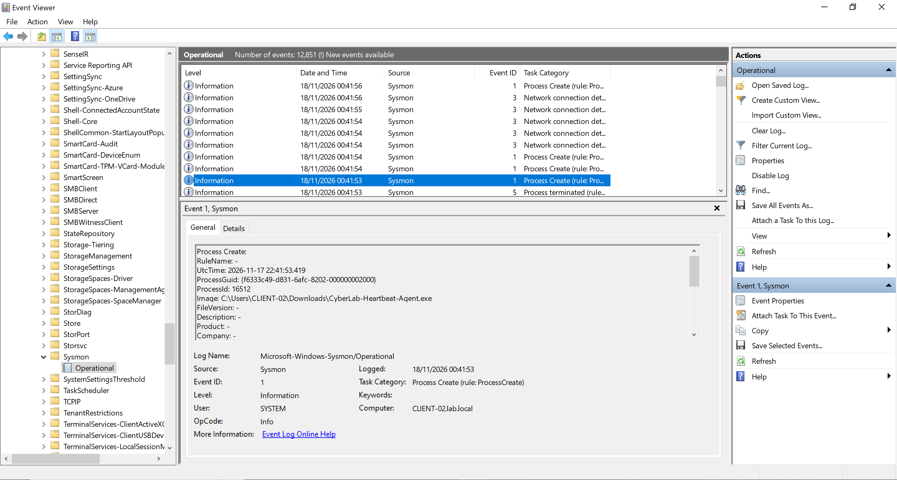

The detailed event properties provided additional information about the process execution, including the executable location and process metadata.

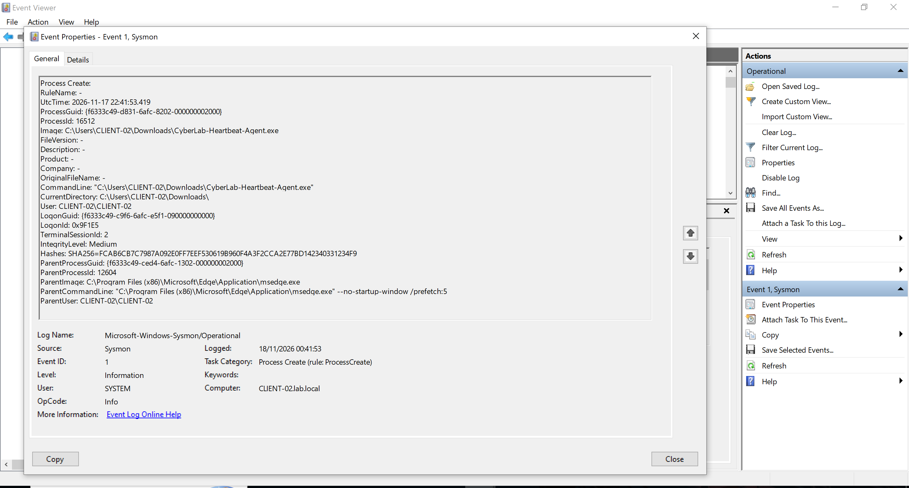

**Event ID 3 – Network Connection**

I also investigated Sysmon Event ID 3 to validate the network communication identified in the Elastic Security alert.

The event showed the following connection details:

| **Parameter** | **Value** |
|---|---|
| Process | CyberLab-Heartbeat-Agent.exe |
| Protocol | TCP |
| Source IP | 10.10.30.20 |
| Source Port | 50816 |
| Destination IP | 10.10.120.10 |
| Destination Port | 80 |
| Destination Service | HTTP |
| Initiated | True |

This event confirmed that the Windows executable initiated an outbound TCP connection to the Ubuntu simulation server.

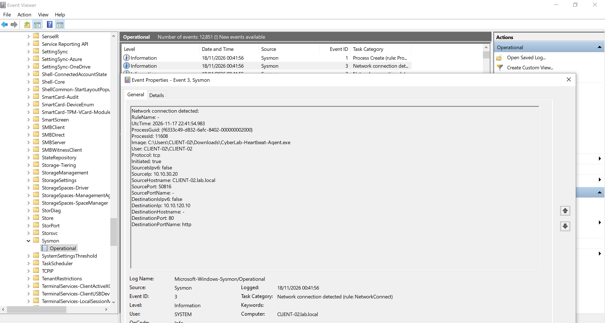

**Elastic Security Event Correlation**

After reviewing the Sysmon events locally, I returned to Elastic Security to correlate the endpoint information with the events collected by the SIEM.

I used the following host filter:

```kql
host.name : "client-02"
```

The Events interface displayed telemetry associated with CLIENT-02, including Sysmon process creation and network connection events.

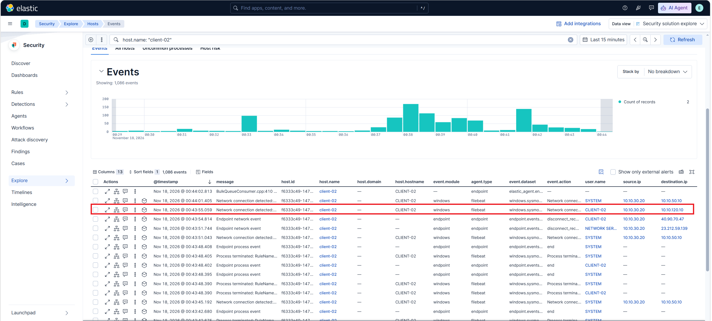

I also reviewed the event associated with the connection to the simulation server.

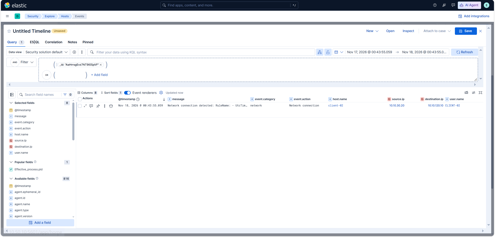

The correlation between Elastic Security and Windows Event Viewer confirmed that the process identified in the alert was responsible for the outbound connection to MALWARE-01.

## 4. Security Monitoring & Investigation

The investigation continued with network-level monitoring and traffic analysis.

The process included:

- Reviewing the Elastic Security detection alert.
- Identifying the process associated with the alert.
- Investigating Sysmon Event ID 1 – Process Creation.
- Investigating Sysmon Event ID 3 – Network Connection.
- Correlating endpoint events with Elastic Security.
- Capturing network traffic using OPNsense.
- Exporting the PCAP file.
- Inspecting HTTP requests and responses using Wireshark.
- Identifying the periodic heartbeat communication pattern.

### 4.1 – OPNsense Packet Capture

I used OPNsense to capture network traffic generated by CLIENT-02.

Navigate to:

```text
Interfaces → Diagnostics → Packet Capture
```
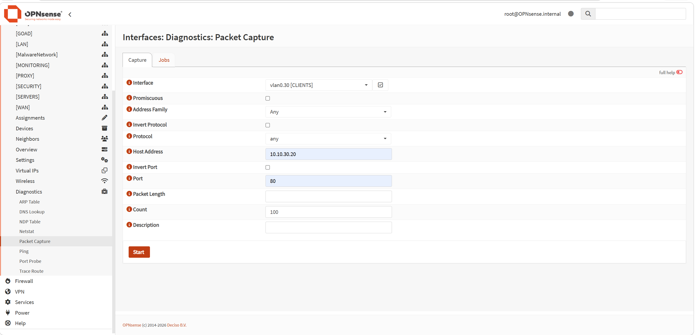
The packet capture was configured with the following parameters:

| **Parameter** | **Configuration** |
|---|---|
| Interface | VLAN 30 – CLIENTS |
| Protocol | Any |
| Host Address | 10.10.30.20 |
| Port | 80 |
| Packet Count | 100 |

The capture was started to monitor HTTP communication between CLIENT-02 and MALWARE-01.


After starting the capture, I reviewed the captured traffic and exported the PCAP file for further analysis.

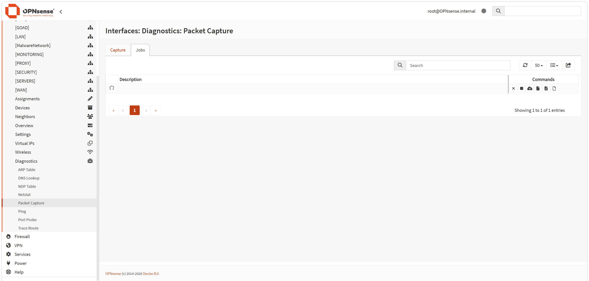

### 4.2 – Wireshark Network Traffic Analysis

After capturing the traffic in OPNsense, I exported the PCAP file and opened it in Wireshark.
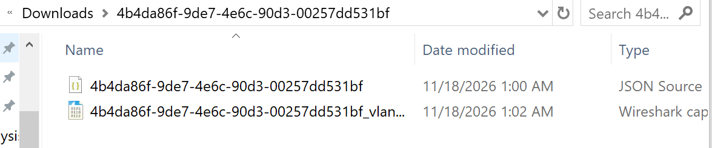
To isolate the communication between the Windows endpoint and the simulation server, I used the following display filter:

```wireshark
ip.addr == 10.10.30.20 && ip.addr == 10.10.120.10
```

The captured traffic showed repeated HTTP communication between the two systems.

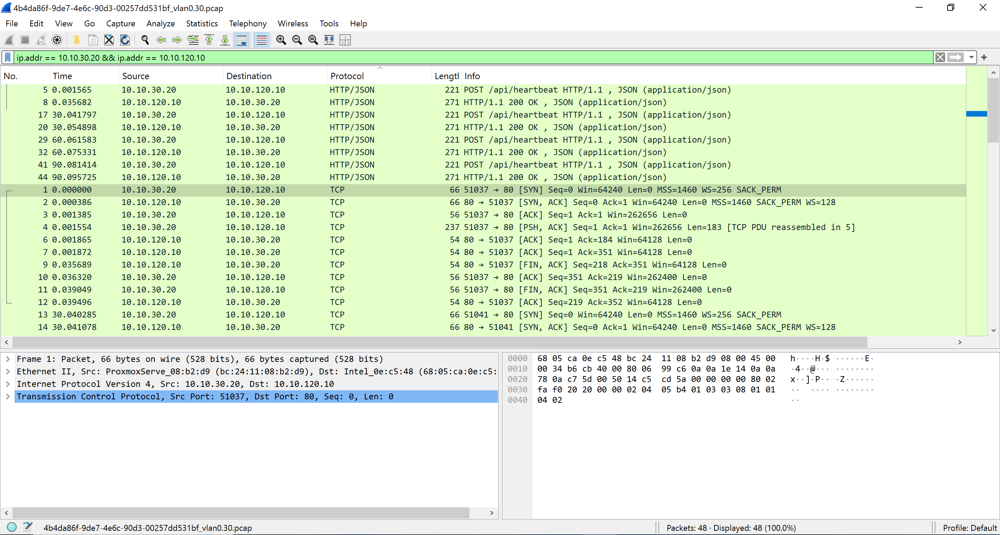

To inspect the HTTP communication in more detail, I used the TCP stream filter:

```wireshark
tcp.stream eq 0
```

The Follow TCP Stream functionality allowed me to inspect the complete HTTP request and response.
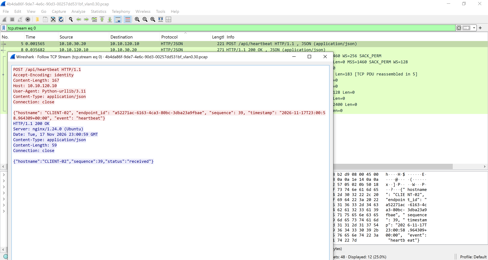
The captured request contained:

```http
POST /api/heartbeat HTTP/1.1
Host: 10.10.120.10
User-Agent: Python-urllib/3.11
Content-Type: application/json
```

The JSON payload contained the endpoint hostname, endpoint ID, sequence number, timestamp, and event type.

Example payload:

```json
{
  "hostname": "CLIENT-02",
  "endpoint_id": "a52271ac-6163-4ca3-80bc-3dba23a9fbae",
  "sequence": 39,
  "timestamp": "2026-11-17T23:00:58.964309+00:00",
  "event": "heartbeat"
}
```

The server response confirmed successful message reception:

```http
HTTP/1.1 200 OK
```

```json
{
  "hostname": "CLIENT-02",
  "sequence": 39,
  "status": "received"
}
```

## 5 – Firewall Enforcement and C2 Communication Blocking

### 5.1 OPNsense Firewall Rule Configuration

After confirming successful heartbeat communication between CLIENT-02 and the simulated C2 server, a firewall rule was introduced to restrict network connectivity.

The rule was configured on the OPNsense **CLIENTS** interface to block traffic from the CLIENTS network to the simulated C2 server.

**Firewall rule parameters:**

| Parameter | Value |
|---|---|
| Description | Block network connection to malware server |
| Interface | CLIENTS |
| Action | Block |
| Direction | In |
| IP Version | IPv4 |
| Protocol | Any |
| Source | CLIENTS network (`10.10.30.0/24`) |
| Destination | `10.10.120.10` |
| Destination Port | Any |
| Logging | Enabled |

The blocking rule was placed above the general allow rule to ensure that traffic targeting the simulated C2 server was blocked before reaching the broader allow condition.

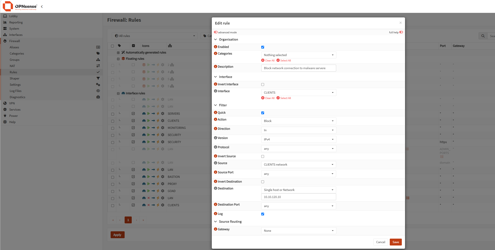

After saving the rule, the configuration changes were applied.


### 5.2 Endpoint Behavior After Firewall Enforcement

After applying the firewall rule, CyberLab-Agent-v2 continued running on CLIENT-02.

The agent continued attempting periodic heartbeat transmissions, but communication with the server started failing.

The endpoint console displayed:

```text
[C2] C2 connection failed: <urlopen error timed out>
```
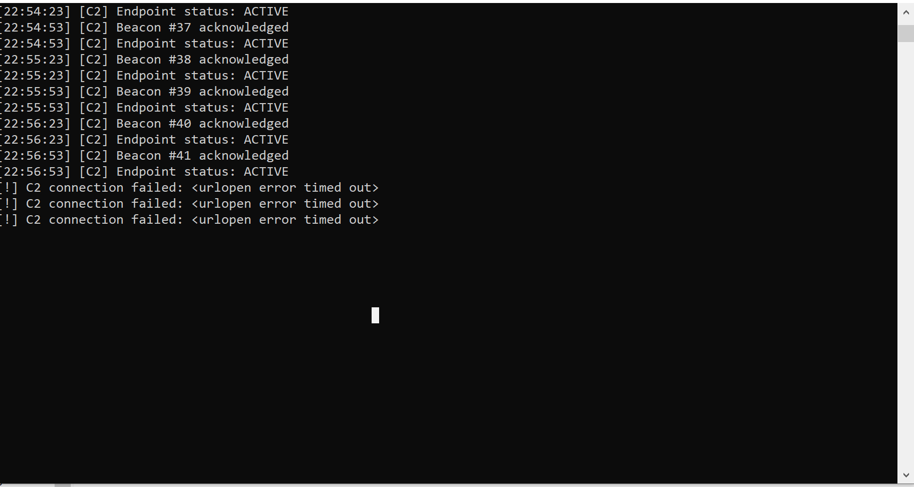
This indicated that the endpoint could no longer establish successful communication with the simulated C2 server.


### 5.3 Network Traffic Verification – Wireshark

To verify the firewall's impact at network level, a new packet capture was performed during subsequent communication attempts.

The following Wireshark display filter was used:

```wireshark
ip.addr == 10.10.30.20 && ip.addr == 10.10.120.10
```

The captured traffic showed:

| Parameter | Observation |
|---|---|
| Source IP | `10.10.30.20` |
| Destination IP | `10.10.120.10` |
| Protocol | TCP |
| Destination Port | 80 |
| TCP Flags | SYN |
| Retransmissions | Observed |
| SYN-ACK responses | Not observed |

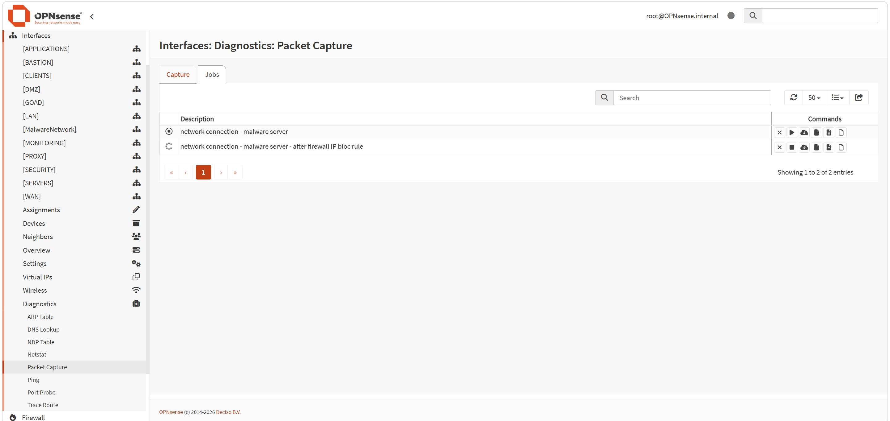

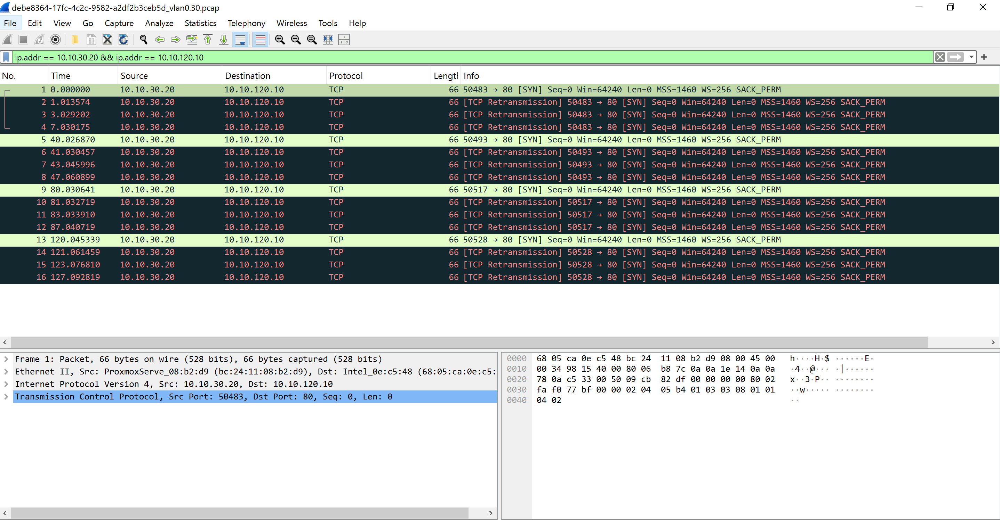

Wireshark showed repeated TCP SYN packets from CLIENT-02 to MALWARE-01, followed by retransmission attempts.

No corresponding SYN-ACK responses were observed, indicating that the TCP connection could not be established.


### 5.4 Firewall Enforcement Result

The test demonstrated that the OPNsense firewall restriction prevented the endpoint from establishing a successful connection with the simulated C2 server.

The results were confirmed through two independent observations:

- **Endpoint monitoring:** connection timeout errors were displayed by CyberLab-Agent-v2.
- **Network traffic analysis:** Wireshark showed repeated TCP SYN retransmissions without successful connection establishment.

This exercise demonstrates how firewall-based network containment can restrict communication between a simulated compromised endpoint and its command-and-control infrastructure.


## 6. Malware Behaviour Analysis
